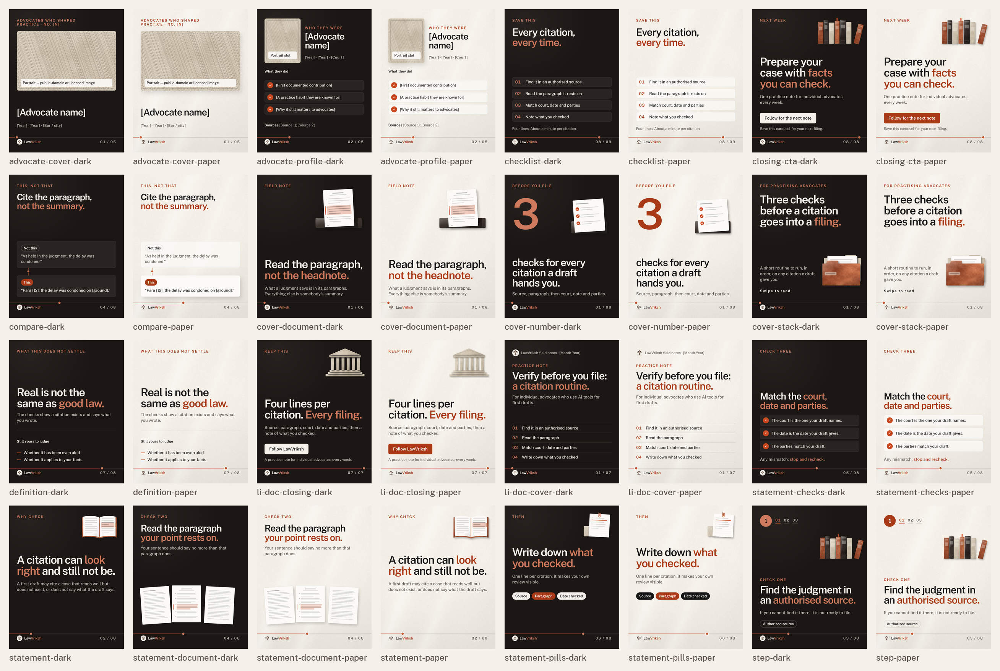
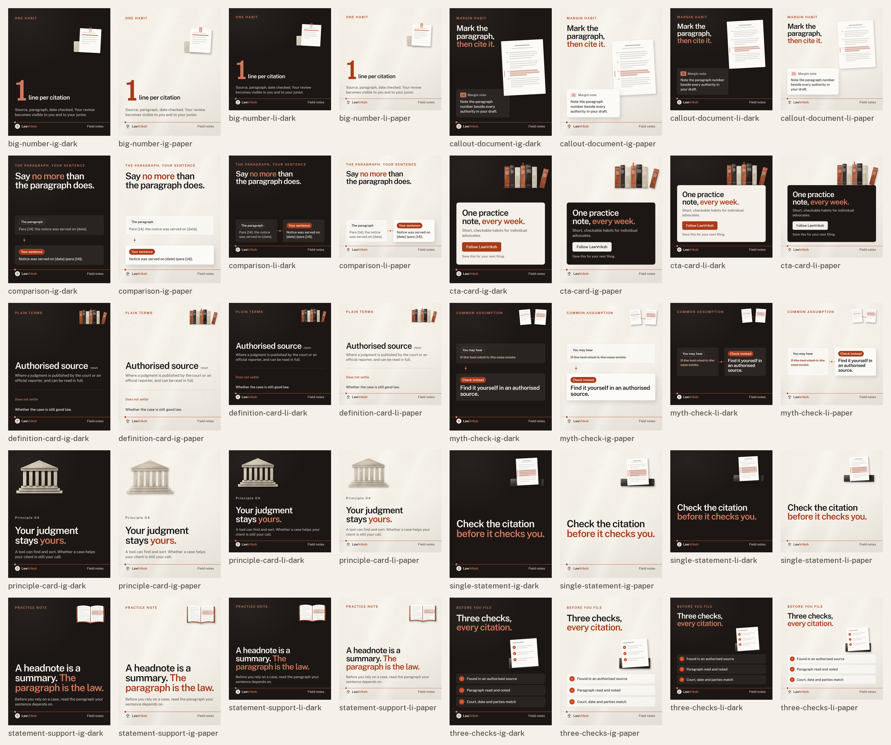
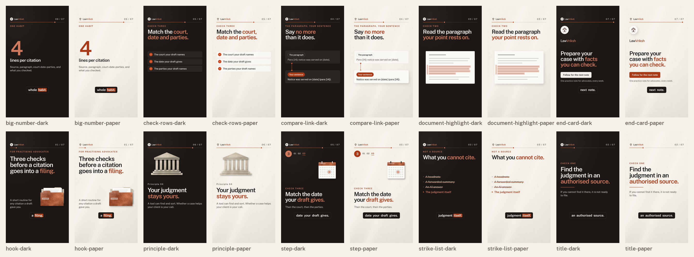

# LawVriksh system — templates and graphics library

Status: **proposed** (6 November 2026). Built for the LawVriksh content pipeline: every carousel, static, reel and YouTube Short is filled from these templates and rendered by Playwright/Chromium from `file://`. Nothing here loads from the network.

Look and feel: *Folio & Thread*. Each piece is a page from a working file: an uppercase clay kicker, one statement, a muted supporting line, and a clay **thread** that runs edge to edge at the same height on every carousel page, with a node that advances page by page, so a swiped carousel reads as one line. Decoration is not abstract: each page carries a **law object** built from the library's stone, sand and paper textures that matches the idea on that page (bound law reports for "authorised source", case files for "filing", a ticked page for "checks", an open report for "read the paragraph", a calendar for "dates", a generic court facade with no emblem, and so on).



## Rules every file follows

- **Type**: LawVriksh Sans 400/500/600, upright only (`font-synthesis: none`; `<b>` is coloured, never bolded past 600; `<i>`/`<em>` render upright and are flagged by the checker). Fonts load from `fonts/` (SIL OFL 1.1, notice in `fonts/LawVrikshSans-OFL.txt`).
- **Palette**: `#171717` ink, `#1c1714` warm ink, `#f5f1ea` paper, `#fbfaf7` surface, `#c94820` clay, `#a93a18` dark clay (emphasis on paper), `#cf795d` edge (emphasis on dark), `#c4562e` thread, `#5a524b` muted. Tints are `rgba()` of these. All are CSS variables in `core/lv.css`.
- **Materials**: textures are referenced in place from `../../brand/textures/` (paper, stone-clay, stone-char, stone-sand, hatch-sand, halftone-ochre); the mark from `../../brand/logos/lawvriksh-mark.png`. Light falls from the upper left; shadows fall down and right.
- **Layout**: text never overlaps text, images or decorative objects; decoration may overlap decoration and cards. No arrows. One idea per page. Min text 34 px on a 1080-wide frame (38 px on 1200). Side safe area ≥ 56 px (templates use 72/80). Reels keep text out of the top 200 px and bottom 380 px.
- **Copy**: example copy is educational ("verify before you file" habits) with no product claims. Placeholders use square brackets: `[Matter name]`, `[date]`, `[source]`, `[n]`.

## Folder map

| Folder | What it holds |
|---|---|
| `core/` | `lv.css` tokens + components, `lv-runtime.js` slot filling + deterministic motion helpers, `lv-motion.js` word reveals, captions, progress, transitions, `lv-objects.js` the ten law objects |
| `carousel/` | 16 slide templates (1080×1350) + `carousel.css`; each with `.schema.json` and `.example.json` |
| `static/` | 10 statics, each composed for Instagram 1080×1350 (`-ig`) and LinkedIn 1200×1200 (`-li`) + `static.css` |
| `reel/` | 10 scene templates, 6 transition demos and 5 caption-style demos (1080×1920, 30 fps) + `reel.css` |
| `graphics/` | layered SVG families (documents, connections, compositions, paper-light), HTML component sheets (citations, badges) + `components.css`, galleries |
| `icons/` | 28 monoline icons × ink/paper/clay, sprites, gallery |
| `product/` | two product compositions (Case Mapping, Chronology) with `.meta.json` — `requires_claim_approval: true` |
| `previews/` | rendered PNG for every template, theme and graphic; contact sheets; filmstrips; `checks.json` |
| `fonts/` | LawVriksh Sans WOFF2 (400/500/600), Medium TTF for contact-sheet labels, OFL notice |
| `tools/` | generator (`build.mjs`), renderer + checker (`render.mjs`, `checks.mjs`), `sheet.py`, `finalize.py` |

## Using a template in the pipeline

```js
// Playwright or Puppeteer, Chromium, offline
await page.setViewportSize({width: 1080, height: 1350});
await page.goto(pathToFileURL('lawvriksh-system/carousel/statement.html').href + '?theme=dark');
await page.evaluate(d => LV.fill(d), data);          // data matches carousel/statement.schema.json
await page.evaluate(() => window.__lvReady);         // fonts + images decoded
await page.screenshot({path: 'slide-02.png'});
```

- `LV.fill(data)` fills named slots: `data-slot` (text), `data-slot-html` (`title_html`, `body_html`: only `<b>` and `<br>` survive the sanitiser; `<b>` renders clay), `data-slot-list` (`rows`, `pills`, `toc`, …; strings or `{text, variant}`), `data-slot-src` (`image`: an empty value shows the labelled frame). `theme` is `paper` or `dark`; `counter: {index, total}` sets the counter text and moves the thread node; `motif` swaps the law object.
- Query parameters also work: `?theme=dark&index=3&total=8`.
- **Reels**: every scene exposes `window.__renderAt(t)` (seconds), `window.__duration`, `window.__fps = 30` and `window.__holdAt` (a representative still). Motion is a pure function of `t`: no `requestAnimationFrame`, timers or randomness. Capture with `for (f = 0; f < __duration * 30; f++) await page.evaluate(t => __renderAt(t), f / 30)`. Captions come from `captions: [{w, s, e}]` word timings; `caption_style` picks one of five styles; `scene_index`/`scene_total` drive the progress thread and counter.

## Carousel templates (1080×1350, Instagram carousel and LinkedIn document)

| Template | Role | Slots | Preview |
|---|---|---|---|
| [Cover A — stacked statement](carousel/cover-stack.html) | cover / hook | `motif`, `kicker`, `title_html`, `body_html`, `swipe`, `counter` | [paper](previews/carousel/cover-stack-paper.png) · [dark](previews/carousel/cover-stack-dark.png) |
| [Cover B — document object](carousel/cover-document.html) | cover / hook | `motif`, `kicker`, `title_html`, `body_html`, `counter` | [paper](previews/carousel/cover-document-paper.png) · [dark](previews/carousel/cover-document-dark.png) |
| [Cover C — oversized numeral](carousel/cover-number.html) | cover / hook | `motif`, `kicker`, `numeral`, `title_html`, `body_html`, `counter` | [paper](previews/carousel/cover-number-paper.png) · [dark](previews/carousel/cover-number-dark.png) |
| [Statement](carousel/statement.html) | content | `motif`, `kicker`, `title_html`, `body_html`, `counter` | [paper](previews/carousel/statement-paper.png) · [dark](previews/carousel/statement-dark.png) |
| [Statement with check rows](carousel/statement-checks.html) | content | `kicker`, `title_html`, `rows`, `body_html`, `counter` | [paper](previews/carousel/statement-checks-paper.png) · [dark](previews/carousel/statement-checks-dark.png) |
| [Statement with pills](carousel/statement-pills.html) | content | `motif`, `kicker`, `title_html`, `body_html`, `pills`, `counter` | [paper](previews/carousel/statement-pills-paper.png) · [dark](previews/carousel/statement-pills-dark.png) |
| [Comparison — this, not that](carousel/compare.html) | content | `kicker`, `title_html`, `not_label`, `not_text`, `this_label`, `this_text`, `counter` | [paper](previews/carousel/compare-paper.png) · [dark](previews/carousel/compare-dark.png) |
| [Numbered step](carousel/step.html) | content | `motif`, `step`, `steps`, `kicker`, `title_html`, `body_html`, `pills`, `counter` | [paper](previews/carousel/step-paper.png) · [dark](previews/carousel/step-dark.png) |
| [Definition — what this does not settle](carousel/definition.html) | content | `kicker`, `title_html`, `body_html`, `list_label`, `rows`, `counter` | [paper](previews/carousel/definition-paper.png) · [dark](previews/carousel/definition-dark.png) |
| [Checklist summary](carousel/checklist.html) | summary | `kicker`, `title_html`, `rows`, `note`, `counter` | [paper](previews/carousel/checklist-paper.png) · [dark](previews/carousel/checklist-dark.png) |
| [Closing / CTA](carousel/closing-cta.html) | closing | `motif`, `kicker`, `title_html`, `body_html`, `button`, `note`, `counter` | [paper](previews/carousel/closing-cta-paper.png) · [dark](previews/carousel/closing-cta-dark.png) |
| [Statement with document](carousel/statement-document.html) | content | `kicker`, `title_html`, `body_html`, `counter` | [paper](previews/carousel/statement-document-paper.png) · [dark](previews/carousel/statement-document-dark.png) |
| [Advocate series — cover](carousel/advocate-cover.html) | series cover | `kicker`, `image`, `image_alt`, `image_label`, `name`, `era`, `body_html`, `counter` | [paper](previews/carousel/advocate-cover-paper.png) · [dark](previews/carousel/advocate-cover-dark.png) |
| [Advocate series — profile](carousel/advocate-profile.html) | series content | `image`, `image_alt`, `image_label`, `kicker`, `name`, `era`, `did_label`, `rows`, `sources`, `counter` | [paper](previews/carousel/advocate-profile-paper.png) · [dark](previews/carousel/advocate-profile-dark.png) |
| [LinkedIn document — cover (PDF page 1)](carousel/li-doc-cover.html) | document cover | `kicker`, `title_html`, `body_html`, `toc`, `edition`, `counter` | [paper](previews/carousel/li-doc-cover-paper.png) · [dark](previews/carousel/li-doc-cover-dark.png) |
| [LinkedIn document — closing](carousel/li-doc-closing.html) | document closing | `motif`, `kicker`, `title_html`, `body_html`, `button`, `note`, `counter` | [paper](previews/carousel/li-doc-closing-paper.png) · [dark](previews/carousel/li-doc-closing-dark.png) |

The advocate series uses an **empty, labelled portrait frame** (hatch-sand treatment). Supply only a public-domain or licensed image through `image`, record its source in `sources`, and never generate a likeness. The LinkedIn document cover carries title, subtitle, contents and an edition line so it reads as a proper first PDF page.

## Static templates



| Template | Instagram 1080×1350 | LinkedIn 1200×1200 | Slots |
|---|---|---|---|
| Single statement | [html](static/single-statement-ig.html) · [png](previews/static/single-statement-ig-paper.png) | [html](static/single-statement-li.html) · [png](previews/static/single-statement-li-paper.png) | `motif`, `title_html`, `series` |
| Statement with supporting line | [html](static/statement-support-ig.html) · [png](previews/static/statement-support-ig-paper.png) | [html](static/statement-support-li.html) · [png](previews/static/statement-support-li-paper.png) | `motif`, `kicker`, `title_html`, `body_html`, `series` |
| Three-point checklist | [html](static/three-checks-ig.html) · [png](previews/static/three-checks-ig-paper.png) | [html](static/three-checks-li.html) · [png](previews/static/three-checks-li-paper.png) | `motif`, `kicker`, `title_html`, `rows`, `series` |
| Comparison | [html](static/comparison-ig.html) · [png](previews/static/comparison-ig-paper.png) | [html](static/comparison-li.html) · [png](previews/static/comparison-li-paper.png) | `kicker`, `title_html`, `a_label`, `a_text`, `b_label`, `b_text`, `series` |
| Myth versus check | [html](static/myth-check-ig.html) · [png](previews/static/myth-check-ig-paper.png) | [html](static/myth-check-li.html) · [png](previews/static/myth-check-li-paper.png) | `motif`, `kicker`, `myth_label`, `myth`, `check_label`, `check_html`, `series` |
| Callout with document | [html](static/callout-document-ig.html) · [png](previews/static/callout-document-ig-paper.png) | [html](static/callout-document-li.html) · [png](previews/static/callout-document-li-paper.png) | `kicker`, `title_html`, `cite`, `callout`, `series` |
| CTA card | [html](static/cta-card-ig.html) · [png](previews/static/cta-card-ig-paper.png) | [html](static/cta-card-li.html) · [png](previews/static/cta-card-li-paper.png) | `motif`, `title_html`, `body_html`, `button`, `note`, `series` |
| Big number / keyword | [html](static/big-number-ig.html) · [png](previews/static/big-number-ig-paper.png) | [html](static/big-number-li.html) · [png](previews/static/big-number-li-paper.png) | `motif`, `kicker`, `number`, `unit`, `body_html`, `series` |
| Definition card | [html](static/definition-card-ig.html) · [png](previews/static/definition-card-ig-paper.png) | [html](static/definition-card-li.html) · [png](previews/static/definition-card-li-paper.png) | `motif`, `kicker`, `term`, `pos`, `body_html`, `not_label`, `not_text`, `series` |
| Principle card | [html](static/principle-card-ig.html) · [png](previews/static/principle-card-ig-paper.png) | [html](static/principle-card-li.html) · [png](previews/static/principle-card-li-paper.png) | `motif`, `number`, `title_html`, `body_html`, `series` |

Schemas: `static/<name>.schema.json` (shared by both sizes); examples: `static/<name>-ig.example.json`.

## Reel and Shorts scenes (1080×1920, 30 fps)

Text zone y 300–1330; caption band y 1372–1520; progress thread + counter y 206–290; nothing below y 1540 or above y 200.



| Scene | Duration | Motion (all deterministic in t) | Slots |
|---|---|---|---|
| [Hook](reel/hook.html) | 4 s | Kicker fades up (0.1 s). Statement rises word by word (0.35 s, 0.09 s stagger). Case files settle up from below (1.0–1.8 s). Supporting line fades up (1.7 s). | `kicker`, `title_html`, `body_html`, `motif`, `scene_index`, `scene_total`, `caption_style`, `captions` |
| [Kicker, title, supporting line](reel/title.html) | 4 s | Kicker (0.1 s), statement word by word (0.3 s), a short thread draws under it (1.1–1.6 s), supporting line (1.4 s). | `kicker`, `title_html`, `body_html`, `scene_index`, `scene_total`, `caption_style`, `captions` |
| [Document highlight](reel/document-highlight.html) | 5 s | Statement fades up (0.1 s). The page slides up (0.4–1.1 s). The highlight sweeps line by line across one paragraph (1.3–2.7 s); a clay margin mark grows beside it (2.6–3.0 s). | `kicker`, `title_html`, `lines`, `scene_index`, `scene_total`, `caption_style`, `captions` |
| [Strike-out list](reel/strike-list.html) | 5 s | Title fades up. Items appear (0.5 s, 0.15 s stagger). A clay strike draws through each struck item in turn (1.3, 1.8, 2.3 s) and it dims. The kept item gains a thread dot and turns full strength (2.9 s). | `kicker`, `title_html`, `struck`, `kept`, `scene_index`, `scene_total`, `caption_style`, `captions` |
| [Two-card comparison with link line](reel/compare-link.html) | 5 s | Title fades up. The first card rises (0.5 s). A clay link line draws down between the cards with a node at each end, no arrowhead (1.2–1.8 s). The second card rises (1.7 s). | `kicker`, `title_html`, `a_label`, `a_text`, `b_label`, `b_text`, `scene_index`, `scene_total`, `caption_style`, `captions` |
| [Check rows, one by one](reel/check-rows.html) | 5 s | Title fades up. Each row rises 0.55 s after the last (from 1.0 s); its tick circle scales in 0.15 s after the row. | `kicker`, `title_html`, `rows`, `scene_index`, `scene_total`, `caption_style`, `captions` |
| [Numbered step](reel/step.html) | 4.5 s | Badge scales in (0.1 s). Step track fades up; the current step’s thread underline draws (0.6–1.0 s). Calendar settles in (0.8 s). Kicker, statement and supporting line follow (1.0, 1.15, 1.6 s). | `step`, `steps`, `kicker`, `title_html`, `body_html`, `motif`, `scene_index`, `scene_total`, `caption_style`, `captions` |
| [Big number / keyword](reel/big-number.html) | 4 s | The number counts up from zero in whole steps (0.3–1.3 s, eased). Unit fades in beside it (1.1 s). Supporting line (1.5 s). For a keyword, set number to text: it rises instead of counting. | `kicker`, `number`, `unit`, `body_html`, `scene_index`, `scene_total`, `caption_style`, `captions` |
| [Principle card](reel/principle.html) | 4.5 s | The court facade rises into place (0.2–1.2 s). Principle number fades up (0.9 s); statement rises word by word (1.05 s); supporting line (2.0 s). No quotation marks: a principle, not a quote. | `number`, `title_html`, `body_html`, `motif`, `scene_index`, `scene_total`, `caption_style`, `captions` |
| [End card](reel/end-card.html) | 4.5 s | Mark scales in on its paper disc (0.1 s); wordmark fades (0.4 s); closing line rises word by word (0.6 s); button rises (1.5 s); note fades (1.9 s). The progress thread reaches its last node. | `title_html`, `button`, `note`, `scene_index`, `scene_total`, `caption_style`, `captions` |

Filmstrip: [previews/reel-filmstrip.png](previews/reel-filmstrip.png).

### Transitions

Each is a function `LV.transitions[name]`, called with the overlay element and `p` from 0 to 1 over the transition window. At `p = 0.5` the overlay covers the whole frame; switch scenes exactly there, so two scenes' text never share a frame. The checker hit-tests a 27×41 grid at the midpoint (`fullCover`).

| Transition | Description | Demo | Midpoint |
|---|---|---|---|
| Clay wipe | A clay panel sweeps in from the left, covers the frame at the midpoint, and leaves to the right. | [reel/transition-clay-wipe.html](reel/transition-clay-wipe.html) | [png](previews/transitions/transition-clay-wipe-midpoint.png) |
| Paper fold | Two paper leaves fold in from top and bottom on a centre crease, meet at the midpoint, and fold away. | [reel/transition-paper-fold.html](reel/transition-paper-fold.html) | [png](previews/transitions/transition-paper-fold-midpoint.png) |
| Stone-block slide | Three stone slabs (sand, clay, char) slide up in a stagger, overlap to cover at the midpoint, and lift away. | [reel/transition-stone-slide.html](reel/transition-stone-slide.html) | [png](previews/transitions/transition-stone-slide-midpoint.png) |
| Thread draw | A clay thread draws across the middle with a travelling node, thickens until it fills the frame at the midpoint, then thins away. | [reel/transition-thread-draw.html](reel/transition-thread-draw.html) | [png](previews/transitions/transition-thread-draw-midpoint.png) |
| Ink iris from the node | Warm ink spreads from the progress thread’s first node to fill the frame, then recedes into the last node. | [reel/transition-ink-iris.html](reel/transition-ink-iris.html) | [png](previews/transitions/transition-ink-iris-midpoint.png) |
| Ink-to-paper flip | An ink leaf turns in from the right edge; at the midpoint it is face-on, then its paper side turns away to the left. | [reel/transition-ink-paper-flip.html](reel/transition-ink-paper-flip.html) | [png](previews/transitions/transition-ink-paper-flip-midpoint.png) |

Filmstrip (1.0–2.0 s): [previews/transitions-filmstrip.png](previews/transitions-filmstrip.png).

### Caption styles (band y 1372–1520, ≥ 46 px; 54–72 px used)

| Style | Description | Demo |
|---|---|---|
| `ink-band` | Warm-ink bar, paper words; the spoken word sits on a dark-clay chip. | [paper](previews/captions/caption-ink-band-paper.png) · [dark](previews/captions/caption-ink-band-dark.png) |
| `paper-slip` | Surface slip with a soft shadow; ink words; a thread underline marks the spoken word. | [paper](previews/captions/caption-paper-slip-paper.png) · [dark](previews/captions/caption-paper-slip-dark.png) |
| `edge-word` | Rounded ink band; unspoken words a touch dimmer, the spoken word in edge clay. | [paper](previews/captions/caption-edge-word-paper.png) · [dark](previews/captions/caption-edge-word-dark.png) |
| `stack` | Two large words at a time on a surface card (72 px); the spoken word in dark clay. | [paper](previews/captions/caption-stack-paper.png) · [dark](previews/captions/caption-stack-dark.png) |
| `highlighter` | Surface card; the spoken word gets a clay highlighter sweep behind ink text. | [paper](previews/captions/caption-highlighter-paper.png) · [dark](previews/captions/caption-highlighter-dark.png) |

Every style sits on its own solid band, so it reads the same over dark and paper scenes. Pages hold up to four words and never end on a lone word. Schema: `reel/captions.schema.json`.

### Progress and counter

`.reel-progress` is a 4 px thread across the top safe line with a node at the current position; `LV.progress(root, t, duration, index, total)` advances it within the scene's share of the series. The counter (`data-slot="reel_counter"`, 36 px) sits beside the wordmark above it.

## Graphics

| Family | Files | Gallery | Count |
|---|---|---|---|
| documents | `graphics/documents/*-paper.svg`, `*-dark.svg` — Judgment, draft, filing, notes, highlighted, folded and report pages; stacked pages; stacked case files; open bound law report; bound volumes. Body text is greeked bars. | [paper](previews/graphics/documents-paper-paper.png) · [dark](previews/graphics/documents-dark-dark.png) · [individual](previews/svg-documents-contact-sheet.png) | 11 × 2 |
| connections | `graphics/connections/*-paper.svg`, `*-dark.svg` — Straight, stations, elbow, S-curve, dashed, one-to-two, one-to-three, converge, timeline, braid, loop-back. No arrowheads anywhere. | [paper](previews/graphics/connections-paper-paper.png) · [dark](previews/graphics/connections-dark-dark.png) · [individual](previews/svg-connections-contact-sheet.png) | 11 × 2 |
| compositions | `graphics/compositions/*-paper.svg`, `*-dark.svg` — Law-object compositions at three scales: cover decorations, corner accents, clusters. | [paper](previews/graphics/compositions-paper-paper.png) · [dark](previews/graphics/compositions-dark-dark.png) · [individual](previews/svg-compositions-contact-sheet.png) | 11 × 2 |
| paper-light | `graphics/paper-light/*-paper.svg`, `*-dark.svg` — Window-light bands, mullion shadows, vignettes, torn edges, folded corner, centre crease, paper-stack edge (1080×1350 overlays). | [paper](previews/graphics/paper-light-paper-paper.png) · [dark](previews/graphics/paper-light-dark-dark.png) · [individual](previews/svg-paper-light-contact-sheet.png) | 11 × 2 |
| law objects | `core/lv-objects.js` (`data-motif="reports"`, `files`, `checked`, `open-book`, `courthouse`, `calendar`, `notes`, `compare`, `judgment`, `register`) | [paper](previews/graphics/law-objects-paper.png) · [dark](previews/graphics/law-objects-dark.png) | 10 × 2 |
| citation and evidence | `graphics/components.css` — chips `[1]`, solid/outline chips, pinpoint chip, highlight, underline thread, boxed phrase, margin mark, margin dot, ¶ and § markers, pinpoint line, source line, margin-note card, strong highlight (live HTML text) | [paper](previews/graphics/citations-paper.png) · [dark](previews/graphics/citations-dark.png) | 16 × 2 |
| badges, rules, pills, buttons | `graphics/components.css` — 5 number badges, numeral, step label, counter; 6 dividers; 6 pills; 6 buttons (no arrows) | [paper](previews/graphics/badges-paper.png) · [dark](previews/graphics/badges-dark.png) | 23 × 2 |
| icons | `icons/<name>-paper.svg` (ink), `-dark.svg` (paper), `-clay.svg`; `sprite-paper.svg`, `sprite-dark.svg` (`#lv-<name>`). 2 px monoline at 24, round caps | [paper](previews/icons/icons-paper-paper.png) · [dark](previews/icons/icons-dark-dark.png) | 28 × 3 |

Icons: bookmark, calendar, check, clip, clock, compare, court, cross-out, document, filter, folder, hearing, highlight, index, link, list, note, page-stack, paragraph, pen, pin, read, search, section-mark, sort, tag, timeline, verify.

## Product graphics (two only)

Rebuilt as layered HTML/CSS/SVG from local product captures, not redesigned; placeholder data only. **Both are `requires_claim_approval: true` and must not be used publicly until the founder approves the specific capability shown.** Case Mapping and Chronology are separate files and separate features; Fact Review is not shown and nothing merges them.

| Composition | Source evidence | Metadata | Preview |
|---|---|---|---|
| [Case Mapping](product/case-mapping.html) | `motion-demo/screenshots/21-arora-map-root-current.png` | [meta](product/case-mapping.meta.json) | [png](previews/product/case-mapping-paper.png) |
| [Chronology](product/chronology.html) | `motion-demo/screenshots/11-chronology-expanded-corpus.png` | [meta](product/chronology.meta.json) | [png](previews/product/chronology-paper.png) |

Deviations (recorded in each `.meta.json`): LawVriksh Sans replaces the product face; colours are mapped to tokens (the green status dot and source glyphs become thread/muted); the credits panel is left out. UI text is at product scale, so crop and enlarge until text is ≥ 34 px on a 1080 frame, or use it as a non-reading visual.

## Self-check

Produced by `tools/render.mjs` + `tools/checks.mjs` in headless Chromium against the rendered DOM, for every template in both themes (reels at their hold time and their last frame; transitions before and after the switch, plus the midpoint cover test). Raw results: [previews/checks.json](previews/checks.json).

How each check works: **fonts** — every text node's computed family is LawVriksh Sans at 400/500/600 and those faces are loaded. **no italics** — computed `font-style` is normal everywhere and no `<i>`/`<em>` exists. **palette** — every computed colour, background, gradient stop, shadow, SVG fill/stroke is a token (any alpha). **no text overlap** — glyph bands (each line's content box inset 18 % top and bottom) of different elements never intersect each other, images, law objects or the thread. **safe area** — text ≥ 56 px from the sides; reels also y 200–1540. **min 34 px** — computed size ≥ 34 px at 1080 wide (≥ 37.8 px at 1200). **contrast** — text over its composited background (textured paper measured at its darker value) ≥ 4.5:1 below 60 px, ≥ 3:1 above. **no arrows** — no arrow characters (U+2190–21FF, 2794–27BF, 2B00–2BFF …), `->`/`=>`, or SVG markers. Arrow-like *shapes* were also reviewed by eye: connectors end in round nodes only. Gallery sheets skip safe-area/min-size (they are not delivery frames) and product compositions skip min-size (see above).

| Template | LawVriksh Sans only | No italics | Palette only | No text overlap | Safe area | Min 34 px | Contrast | No arrows | Min px | Min contrast |
|---|---|---|---|---|---|---|---|---|---|---|
| carousel/cover-stack | pass | pass | pass | pass | pass | pass | pass | pass | 34 | 5.54 |
| carousel/cover-document | pass | pass | pass | pass | pass | pass | pass | pass | 34 | 5.54 |
| carousel/cover-number | pass | pass | pass | pass | pass | pass | pass | pass | 34 | 5.54 |
| carousel/statement | pass | pass | pass | pass | pass | pass | pass | pass | 34 | 5.54 |
| carousel/statement-checks | pass | pass | pass | pass | pass | pass | pass | pass | 34 | 5.54 |
| carousel/statement-pills | pass | pass | pass | pass | pass | pass | pass | pass | 34 | 5.54 |
| carousel/compare | pass | pass | pass | pass | pass | pass | pass | pass | 34 | 5.54 |
| carousel/step | pass | pass | pass | pass | pass | pass | pass | pass | 34 | 5.54 |
| carousel/definition | pass | pass | pass | pass | pass | pass | pass | pass | 34 | 5.54 |
| carousel/checklist | pass | pass | pass | pass | pass | pass | pass | pass | 34 | 4.78 |
| carousel/closing-cta | pass | pass | pass | pass | pass | pass | pass | pass | 34 | 5.54 |
| carousel/statement-document | pass | pass | pass | pass | pass | pass | pass | pass | 34 | 5.54 |
| carousel/advocate-cover | pass | pass | pass | pass | pass | pass | pass | pass | 34 | 5.54 |
| carousel/advocate-profile | pass | pass | pass | pass | pass | pass | pass | pass | 34 | 5.54 |
| carousel/li-doc-cover | pass | pass | pass | pass | pass | pass | pass | pass | 34 | 5.54 |
| carousel/li-doc-closing | pass | pass | pass | pass | pass | pass | pass | pass | 34 | 5.54 |
| static/single-statement-ig | pass | pass | pass | pass | pass | pass | pass | pass | 34 | 5.54 |
| static/single-statement-li | pass | pass | pass | pass | pass | pass | pass | pass | 38 | 5.54 |
| static/statement-support-ig | pass | pass | pass | pass | pass | pass | pass | pass | 34 | 5.54 |
| static/statement-support-li | pass | pass | pass | pass | pass | pass | pass | pass | 38 | 5.54 |
| static/three-checks-ig | pass | pass | pass | pass | pass | pass | pass | pass | 34 | 5.54 |
| static/three-checks-li | pass | pass | pass | pass | pass | pass | pass | pass | 38 | 5.54 |
| static/comparison-ig | pass | pass | pass | pass | pass | pass | pass | pass | 34 | 5.54 |
| static/comparison-li | pass | pass | pass | pass | pass | pass | pass | pass | 38 | 5.54 |
| static/myth-check-ig | pass | pass | pass | pass | pass | pass | pass | pass | 34 | 5.54 |
| static/myth-check-li | pass | pass | pass | pass | pass | pass | pass | pass | 38 | 5.54 |
| static/callout-document-ig | pass | pass | pass | pass | pass | pass | pass | pass | 34 | 5.17 |
| static/callout-document-li | pass | pass | pass | pass | pass | pass | pass | pass | 38 | 5.17 |
| static/cta-card-ig | pass | pass | pass | pass | pass | pass | pass | pass | 34 | 5.54 |
| static/cta-card-li | pass | pass | pass | pass | pass | pass | pass | pass | 38 | 5.54 |
| static/big-number-ig | pass | pass | pass | pass | pass | pass | pass | pass | 34 | 5.54 |
| static/big-number-li | pass | pass | pass | pass | pass | pass | pass | pass | 38 | 5.54 |
| static/definition-card-ig | pass | pass | pass | pass | pass | pass | pass | pass | 34 | 5.54 |
| static/definition-card-li | pass | pass | pass | pass | pass | pass | pass | pass | 38 | 5.54 |
| static/principle-card-ig | pass | pass | pass | pass | pass | pass | pass | pass | 34 | 5.54 |
| static/principle-card-li | pass | pass | pass | pass | pass | pass | pass | pass | 38 | 5.54 |
| reel/hook | pass | pass | pass | pass | pass | pass | pass | pass | 36 | 5.54 |
| reel/title | pass | pass | pass | pass | pass | pass | pass | pass | 36 | 5.54 |
| reel/document-highlight | pass | pass | pass | pass | pass | pass | pass | pass | 36 | 5.54 |
| reel/strike-list | pass | pass | pass | pass | pass | pass | pass | pass | 36 | 5.54 |
| reel/compare-link | pass | pass | pass | pass | pass | pass | pass | pass | 36 | 5.54 |
| reel/check-rows | pass | pass | pass | pass | pass | pass | pass | pass | 36 | 5.54 |
| reel/step | pass | pass | pass | pass | pass | pass | pass | pass | 36 | 5.54 |
| reel/big-number | pass | pass | pass | pass | pass | pass | pass | pass | 36 | 5.54 |
| reel/principle | pass | pass | pass | pass | pass | pass | pass | pass | 36 | 5.54 |
| reel/end-card | pass | pass | pass | pass | pass | pass | pass | pass | 36 | 5.54 |
| transitions/transition-clay-wipe (cover: pass) | pass | pass | pass | pass | pass | pass | pass | pass | 36 | 5.54 |
| transitions/transition-paper-fold (cover: pass) | pass | pass | pass | pass | pass | pass | pass | pass | 36 | 5.54 |
| transitions/transition-stone-slide (cover: pass) | pass | pass | pass | pass | pass | pass | pass | pass | 36 | 5.54 |
| transitions/transition-thread-draw (cover: pass) | pass | pass | pass | pass | pass | pass | pass | pass | 36 | 5.54 |
| transitions/transition-ink-iris (cover: pass) | pass | pass | pass | pass | pass | pass | pass | pass | 36 | 5.54 |
| transitions/transition-ink-paper-flip (cover: pass) | pass | pass | pass | pass | pass | pass | pass | pass | 36 | 5.54 |
| captions/caption-ink-band | pass | pass | pass | pass | pass | pass | pass | pass | 36 | 5.54 |
| captions/caption-paper-slip | pass | pass | pass | pass | pass | pass | pass | pass | 36 | 5.54 |
| captions/caption-edge-word | pass | pass | pass | pass | pass | pass | pass | pass | 36 | 5.54 |
| captions/caption-stack | pass | pass | pass | pass | pass | pass | pass | pass | 36 | 5.54 |
| captions/caption-highlighter | pass | pass | pass | pass | pass | pass | pass | pass | 36 | 5.54 |
| graphics/documents-paper | pass | pass | pass | pass | n/a | n/a | pass | pass | 34 | 5.64 |
| graphics/documents-dark | pass | pass | pass | pass | n/a | n/a | pass | pass | 34 | 5.54 |
| graphics/connections-paper | pass | pass | pass | pass | n/a | n/a | pass | pass | 34 | 5.64 |
| graphics/connections-dark | pass | pass | pass | pass | n/a | n/a | pass | pass | 34 | 5.54 |
| graphics/compositions-paper | pass | pass | pass | pass | n/a | n/a | pass | pass | 34 | 5.64 |
| graphics/compositions-dark | pass | pass | pass | pass | n/a | n/a | pass | pass | 34 | 5.54 |
| graphics/paper-light-paper | pass | pass | pass | pass | n/a | n/a | pass | pass | 34 | 5.64 |
| graphics/paper-light-dark | pass | pass | pass | pass | n/a | n/a | pass | pass | 34 | 5.54 |
| graphics/law-objects | pass | pass | pass | pass | n/a | n/a | pass | pass | 34 | 15.78 |
| graphics/citations | pass | pass | pass | pass | n/a | pass | pass | pass | 34 | 4.82 |
| graphics/badges | pass | pass | pass | pass | n/a | pass | pass | pass | 34 | 4.82 |
| icons/icons-paper | pass | pass | pass | pass | n/a | pass | pass | pass | 34 | 5.64 |
| icons/icons-dark | pass | pass | pass | pass | n/a | pass | pass | pass | 34 | 5.54 |
| product/case-mapping | pass | pass | pass | pass | n/a | n/a | pass | pass | 9 | 5.69 |
| product/chronology | pass | pass | pass | pass | n/a | n/a | pass | pass | 9 | 6.09 |

Limits: these are automated geometric and colour checks plus the visual review of every contact sheet; they are not a usability study or a rights audit. Contrast on textured paper is computed against a conservative flat value, not per pixel.

## Rebuilding

```bash
node lawvriksh-system/tools/build.mjs                       # regenerate templates, schemas, examples, SVGs
node lawvriksh-system/tools/render.mjs --runtime <puppeteer-core node_modules>   # previews + checks
python lawvriksh-system/tools/finalize.py                    # sheets, README, manifest
```

`render.mjs` uses an existing `puppeteer-core` install and an existing Chromium (it looks in the Playwright cache, or pass `--chrome`). It installs nothing.

## Rights and provenance

| Material | Source | Licence / note |
|---|---|---|
| LawVriksh Sans (WOFF2, Medium TTF) | LawVriksh-Sans-v0.1 package (Public Sans derivative) | SIL Open Font License 1.1 — `fonts/LawVrikshSans-OFL.txt` |
| Textures, mark | This repository: `brand/textures/*`, `brand/logos/lawvriksh-mark.png` (referenced, not copied) | As recorded in `ASSET-RIGHTS.md` |
| Templates, CSS/JS, SVG graphics, law objects, icons | Original work for LawVriksh in this branch | LawVriksh creative work; no third-party marks, emblems, stock or AI imagery |
| Product compositions | Rebuilt from LawVriksh's own product screens (local captures) | Placeholder data only; claim approval required before use |

No stock photos, real faces or likenesses, court or government emblems (including the State Emblem of India), scales-of-justice imagery, other brands' marks or AI-generated text in images are used. The court facade is a generic columned building with an empty pediment.

