# LawVriksh blog — thumbnails, in-article graphics and article page

Status: **proposed**. Built for the blog pipeline on top of `lawvriksh-system/`: it uses `core/lv.css`, `core/lv-runtime.js`, the law objects (`core/lv-objects.js`), the textures, the mark and LawVriksh Sans. Nothing here is loaded from the network, and nothing uses timers or randomness. Each template takes only text and picks components.

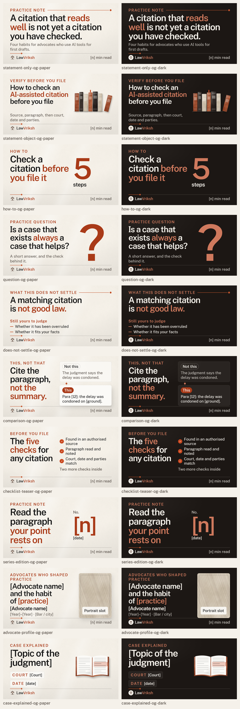

## Rules (unchanged from the system library)

- **Type**: LawVriksh Sans 400/500/600, upright only. Emphasis is clay colour (`<b>` in `title_html`) or weight, never italics.
- **Palette**: the nine tokens only; tints are `rgba()` of them (checked against every computed colour).
- **Layout**: text never overlaps text, images or decorative objects. Decoration may overlap decoration. No arrows, stock photos, faces, emblems or scales.
- **Size**: minimum text is 34 px on a 1080-wide frame, scaled by width: **40 px at 1200**, **24 px at 720** (checked). Contrast ≥ 4.5:1 (3:1 for large text).
- **Decoration means something**: the law objects (reports, files, ticked page, open report, court facade, calendar, notes, paired pages, judgment, register) are chosen to match the idea; there are no abstract blocks.
- **Copy**: placeholders are educational and calm, with no product claims. Variable details use square brackets: `[date]`, `[para]`, `[Court]`, `[n]`. Nothing is stated as law.

## Using a template

```js
await page.goto(pathToFileURL('lawvriksh-system/blog/thumbnails/question-og.html').href);
await page.evaluate(() => window.__lvReady);
await page.evaluate(d => LV.fill(d), data);   // data matches question.schema.json
await page.screenshot({path: 'thumb.png'});
```

- Slots: `data-slot` (text), `data-slot-html` (`<b>` and `<br>` only), `data-slot-list` (strings or objects), `data-slot-src` (image), `data-slot-href` (tracked link), `data-slot-md` (Markdown body). `theme` is `paper` or `dark`; `?theme=dark` also works.
- **Title fitting** (`blog/blog.js`): headlines shrink in 2 px steps from a maximum until they fit their box and line limit (never below a floor of 64–80 px on thumbnails). It is a pure function of the text, so renders are repeatable.
- **Lists** (`data-cols-auto`) choose their column count from the item count and the frame width: 5 items wrap 3+2, 6 items 3+3.

## 1. Thumbnails (10 templates × 3 sizes × paper and dark)

Primary size **1200×630** (blog hero and Open Graph / LinkedIn share image); **1080×1080** and **1080×1350** are recomposed for social posts that point to the article. On the square and portrait versions the headline sits inside the centre **1.91:1 band** (1080×565), so a platform crop keeps it; at **300 px wide** the headline renders at 16 px or more (checked, see below).

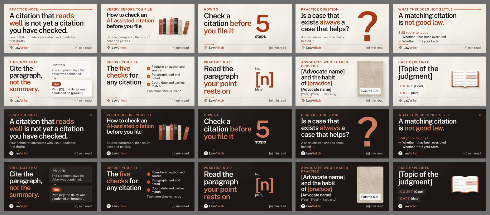

| Template | Layout | Slots | 1200×630 | 1080×1080 | 1080×1350 |
|---|---|---|---|---|---|
| Statement only | Typographic headline across the full width, a thread with a node above it, one support line. | `kicker`, `title_html`, `body_html`, `meta` | [html](thumbnails/statement-only-og.html) · [paper](previews/thumbnails/statement-only-og-paper.png) · [dark](previews/thumbnails/statement-only-og-dark.png) | [html](thumbnails/statement-only-sq.html) · [paper](previews/thumbnails/statement-only-sq-paper.png) · [dark](previews/thumbnails/statement-only-sq-dark.png) | [html](thumbnails/statement-only-pt.html) · [paper](previews/thumbnails/statement-only-pt-paper.png) · [dark](previews/thumbnails/statement-only-pt-dark.png) |
| Statement with a law object | Headline on the left; a law object on the right chosen to match the idea. | `kicker`, `title_html`, `body_html`, `motif`, `meta` | [html](thumbnails/statement-object-og.html) · [paper](previews/thumbnails/statement-object-og-paper.png) · [dark](previews/thumbnails/statement-object-og-dark.png) | [html](thumbnails/statement-object-sq.html) · [paper](previews/thumbnails/statement-object-sq-paper.png) · [dark](previews/thumbnails/statement-object-sq-dark.png) | [html](thumbnails/statement-object-pt.html) · [paper](previews/thumbnails/statement-object-pt-paper.png) · [dark](previews/thumbnails/statement-object-pt-dark.png) |
| How to, with a step count | A large clay numeral states the number of steps; the headline carries the task. | `kicker`, `title_html`, `count`, `count_label`, `meta` | [html](thumbnails/how-to-og.html) · [paper](previews/thumbnails/how-to-og-paper.png) · [dark](previews/thumbnails/how-to-og-dark.png) | [html](thumbnails/how-to-sq.html) · [paper](previews/thumbnails/how-to-sq-paper.png) · [dark](previews/thumbnails/how-to-sq-dark.png) | [html](thumbnails/how-to-pt.html) · [paper](previews/thumbnails/how-to-pt-paper.png) · [dark](previews/thumbnails/how-to-pt-dark.png) |
| Question headline | A question as the headline, a large clay question mark, and a one-line promise of the short answer. | `kicker`, `title_html`, `body_html`, `meta` | [html](thumbnails/question-og.html) · [paper](previews/thumbnails/question-og-paper.png) · [dark](previews/thumbnails/question-og-dark.png) | [html](thumbnails/question-sq.html) · [paper](previews/thumbnails/question-sq-paper.png) · [dark](previews/thumbnails/question-sq-dark.png) | [html](thumbnails/question-pt.html) · [paper](previews/thumbnails/question-pt-paper.png) · [dark](previews/thumbnails/question-pt-dark.png) |
| What this does not settle | Headline plus a short “still yours to judge” list marked with thread dashes. | `kicker`, `title_html`, `list_label`, `rows`, `meta` | [html](thumbnails/does-not-settle-og.html) · [paper](previews/thumbnails/does-not-settle-og-paper.png) · [dark](previews/thumbnails/does-not-settle-og-dark.png) | [html](thumbnails/does-not-settle-sq.html) · [paper](previews/thumbnails/does-not-settle-sq-paper.png) · [dark](previews/thumbnails/does-not-settle-sq-dark.png) | [html](thumbnails/does-not-settle-pt.html) · [paper](previews/thumbnails/does-not-settle-pt-paper.png) · [dark](previews/thumbnails/does-not-settle-pt-dark.png) |
| This, not that | Headline with two cards joined by a clay link line (no arrowhead): the quiet “not this”, the raised “this”. | `kicker`, `title_html`, `not_label`, `not_text`, `this_label`, `this_text`, `meta` | [html](thumbnails/comparison-og.html) · [paper](previews/thumbnails/comparison-og-paper.png) · [dark](previews/thumbnails/comparison-og-dark.png) | [html](thumbnails/comparison-sq.html) · [paper](previews/thumbnails/comparison-sq-paper.png) · [dark](previews/thumbnails/comparison-sq-dark.png) | [html](thumbnails/comparison-pt.html) · [paper](previews/thumbnails/comparison-pt-paper.png) · [dark](previews/thumbnails/comparison-pt-dark.png) |
| Checklist teaser | Headline and the first three checks as tick rows, with a quiet line pointing to the rest. | `kicker`, `title_html`, `rows`, `teaser_more`, `meta` | [html](thumbnails/checklist-teaser-og.html) · [paper](previews/thumbnails/checklist-teaser-og-paper.png) · [dark](previews/thumbnails/checklist-teaser-og-dark.png) | [html](thumbnails/checklist-teaser-sq.html) · [paper](previews/thumbnails/checklist-teaser-sq-paper.png) · [dark](previews/thumbnails/checklist-teaser-sq-dark.png) | [html](thumbnails/checklist-teaser-pt.html) · [paper](previews/thumbnails/checklist-teaser-pt-paper.png) · [dark](previews/thumbnails/checklist-teaser-pt-dark.png) |
| Series edition | Series label, a large edition number and a date line beside the headline (“Practice note No. [n]”). | `series_label`, `edition_no`, `title_html`, `date_line`, `meta` | [html](thumbnails/series-edition-og.html) · [paper](previews/thumbnails/series-edition-og-paper.png) · [dark](previews/thumbnails/series-edition-og-dark.png) | [html](thumbnails/series-edition-sq.html) · [paper](previews/thumbnails/series-edition-sq-paper.png) · [dark](previews/thumbnails/series-edition-sq-dark.png) | [html](thumbnails/series-edition-pt.html) · [paper](previews/thumbnails/series-edition-pt-paper.png) · [dark](previews/thumbnails/series-edition-pt-dark.png) |
| Past-advocate profile | Empty labelled portrait frame (hatch-sand), headline, name and era. No likeness ships in the template. | `kicker`, `title_html`, `name`, `era`, `image`, `image_alt`, `image_label`, `meta` | [html](thumbnails/advocate-profile-og.html) · [paper](previews/thumbnails/advocate-profile-og-paper.png) · [dark](previews/thumbnails/advocate-profile-og-dark.png) | [html](thumbnails/advocate-profile-sq.html) · [paper](previews/thumbnails/advocate-profile-sq-paper.png) · [dark](previews/thumbnails/advocate-profile-sq-dark.png) | [html](thumbnails/advocate-profile-pt.html) · [paper](previews/thumbnails/advocate-profile-pt-paper.png) · [dark](previews/thumbnails/advocate-profile-pt-dark.png) |
| Case explained | Court, date and topic only, as placeholders, beside an open report. No invented case. | `court`, `date`, `topic` | [html](thumbnails/case-explained-og.html) · [paper](previews/thumbnails/case-explained-og-paper.png) · [dark](previews/thumbnails/case-explained-og-dark.png) | [html](thumbnails/case-explained-sq.html) · [paper](previews/thumbnails/case-explained-sq-paper.png) · [dark](previews/thumbnails/case-explained-sq-dark.png) | [html](thumbnails/case-explained-pt.html) · [paper](previews/thumbnails/case-explained-pt-paper.png) · [dark](previews/thumbnails/case-explained-pt-dark.png) |

Schema and example per template: `thumbnails/<template>.schema.json`, `thumbnails/<template>.example.json` (shared by the three sizes). Sheets: [1200×630](previews/thumbnails-og-contact-sheet.png) · [1080×1080](previews/thumbnails-sq-contact-sheet.png) · [1080×1350](previews/thumbnails-pt-contact-sheet.png).

The advocate-profile thumbnail has an **empty, labelled portrait frame** and ships no likeness. The case-explained thumbnail has exactly three slots (`court`, `date`, `topic`), all placeholders; no case is invented.

## 2. In-article graphics (10 families × 10 variants × widths 1200 and 720 × paper and dark)

Live HTML text on a flat ground (the paper grain stays in thumbnails so the graphic sits cleanly in a reading column). Height follows the content. Each variant has one schema and one example shared by its two widths and both themes. Horizontal layouts wrap on the narrow width.

### Process steps

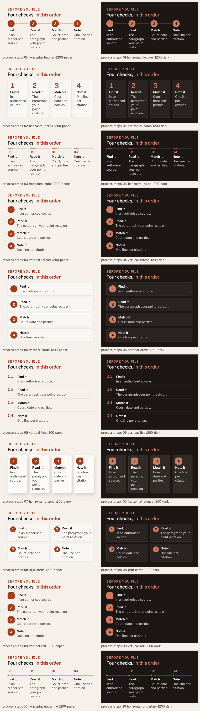

| Variant | Slots | 1200 | 720 |
|---|---|---|---|
| Process steps 1 — horizontal-badges | `kicker`, `title_html`, `steps` | [html](graphics/process-steps-01-horizontal-badges-1200.html) · [paper](previews/graphics/process-steps-01-horizontal-badges-1200-paper.png) · [dark](previews/graphics/process-steps-01-horizontal-badges-1200-dark.png) | [html](graphics/process-steps-01-horizontal-badges-720.html) · [paper](previews/graphics/process-steps-01-horizontal-badges-720-paper.png) · [dark](previews/graphics/process-steps-01-horizontal-badges-720-dark.png) |
| Process steps 2 — horizontal-cards | `kicker`, `title_html`, `steps` | [html](graphics/process-steps-02-horizontal-cards-1200.html) · [paper](previews/graphics/process-steps-02-horizontal-cards-1200-paper.png) · [dark](previews/graphics/process-steps-02-horizontal-cards-1200-dark.png) | [html](graphics/process-steps-02-horizontal-cards-720.html) · [paper](previews/graphics/process-steps-02-horizontal-cards-720-paper.png) · [dark](previews/graphics/process-steps-02-horizontal-cards-720-dark.png) |
| Process steps 3 — horizontal-rules | `kicker`, `title_html`, `steps` | [html](graphics/process-steps-03-horizontal-rules-1200.html) · [paper](previews/graphics/process-steps-03-horizontal-rules-1200-paper.png) · [dark](previews/graphics/process-steps-03-horizontal-rules-1200-dark.png) | [html](graphics/process-steps-03-horizontal-rules-720.html) · [paper](previews/graphics/process-steps-03-horizontal-rules-720-paper.png) · [dark](previews/graphics/process-steps-03-horizontal-rules-720-dark.png) |
| Process steps 4 — vertical-thread | `kicker`, `title_html`, `steps` | [html](graphics/process-steps-04-vertical-thread-1200.html) · [paper](previews/graphics/process-steps-04-vertical-thread-1200-paper.png) · [dark](previews/graphics/process-steps-04-vertical-thread-1200-dark.png) | [html](graphics/process-steps-04-vertical-thread-720.html) · [paper](previews/graphics/process-steps-04-vertical-thread-720-paper.png) · [dark](previews/graphics/process-steps-04-vertical-thread-720-dark.png) |
| Process steps 5 — vertical-cards | `kicker`, `title_html`, `steps` | [html](graphics/process-steps-05-vertical-cards-1200.html) · [paper](previews/graphics/process-steps-05-vertical-cards-1200-paper.png) · [dark](previews/graphics/process-steps-05-vertical-cards-1200-dark.png) | [html](graphics/process-steps-05-vertical-cards-720.html) · [paper](previews/graphics/process-steps-05-vertical-cards-720-paper.png) · [dark](previews/graphics/process-steps-05-vertical-cards-720-dark.png) |
| Process steps 6 — vertical-list | `kicker`, `title_html`, `steps` | [html](graphics/process-steps-06-vertical-list-1200.html) · [paper](previews/graphics/process-steps-06-vertical-list-1200-paper.png) · [dark](previews/graphics/process-steps-06-vertical-list-1200-dark.png) | [html](graphics/process-steps-06-vertical-list-720.html) · [paper](previews/graphics/process-steps-06-vertical-list-720-paper.png) · [dark](previews/graphics/process-steps-06-vertical-list-720-dark.png) |
| Process steps 7 — horizontal-stones | `kicker`, `title_html`, `steps` | [html](graphics/process-steps-07-horizontal-stones-1200.html) · [paper](previews/graphics/process-steps-07-horizontal-stones-1200-paper.png) · [dark](previews/graphics/process-steps-07-horizontal-stones-1200-dark.png) | [html](graphics/process-steps-07-horizontal-stones-720.html) · [paper](previews/graphics/process-steps-07-horizontal-stones-720-paper.png) · [dark](previews/graphics/process-steps-07-horizontal-stones-720-dark.png) |
| Process steps 8 — grid-cards | `kicker`, `title_html`, `steps` | [html](graphics/process-steps-08-grid-cards-1200.html) · [paper](previews/graphics/process-steps-08-grid-cards-1200-paper.png) · [dark](previews/graphics/process-steps-08-grid-cards-1200-dark.png) | [html](graphics/process-steps-08-grid-cards-720.html) · [paper](previews/graphics/process-steps-08-grid-cards-720-paper.png) · [dark](previews/graphics/process-steps-08-grid-cards-720-dark.png) |
| Process steps 9 — vertical-rail | `kicker`, `title_html`, `steps` | [html](graphics/process-steps-09-vertical-rail-1200.html) · [paper](previews/graphics/process-steps-09-vertical-rail-1200-paper.png) · [dark](previews/graphics/process-steps-09-vertical-rail-1200-dark.png) | [html](graphics/process-steps-09-vertical-rail-720.html) · [paper](previews/graphics/process-steps-09-vertical-rail-720-paper.png) · [dark](previews/graphics/process-steps-09-vertical-rail-720-dark.png) |
| Process steps 10 — horizontal-underline | `kicker`, `title_html`, `steps` | [html](graphics/process-steps-10-horizontal-underline-1200.html) · [paper](previews/graphics/process-steps-10-horizontal-underline-1200-paper.png) · [dark](previews/graphics/process-steps-10-horizontal-underline-1200-dark.png) | [html](graphics/process-steps-10-horizontal-underline-720.html) · [paper](previews/graphics/process-steps-10-horizontal-underline-720-paper.png) · [dark](previews/graphics/process-steps-10-horizontal-underline-720-dark.png) |

Mobile sheet: [previews/graphics-process-steps-720-contact-sheet.png](previews/graphics-process-steps-720-contact-sheet.png). Schemas: `graphics/process-steps-NN-*.schema.json`.

### Checklist cards

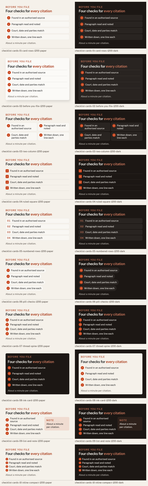

| Variant | Slots | 1200 | 720 |
|---|---|---|---|
| Checklist card 1 — card-rows | `kicker`, `title_html`, `rows`, `note` | [html](graphics/checklist-cards-01-card-rows-1200.html) · [paper](previews/graphics/checklist-cards-01-card-rows-1200-paper.png) · [dark](previews/graphics/checklist-cards-01-card-rows-1200-dark.png) | [html](graphics/checklist-cards-01-card-rows-720.html) · [paper](previews/graphics/checklist-cards-01-card-rows-720-paper.png) · [dark](previews/graphics/checklist-cards-01-card-rows-720-dark.png) |
| Checklist card 2 — before-you-file | `kicker`, `title_html`, `rows`, `note` | [html](graphics/checklist-cards-02-before-you-file-1200.html) · [paper](previews/graphics/checklist-cards-02-before-you-file-1200-paper.png) · [dark](previews/graphics/checklist-cards-02-before-you-file-1200-dark.png) | [html](graphics/checklist-cards-02-before-you-file-720.html) · [paper](previews/graphics/checklist-cards-02-before-you-file-720-paper.png) · [dark](previews/graphics/checklist-cards-02-before-you-file-720-dark.png) |
| Checklist card 3 — two-column | `kicker`, `title_html`, `rows`, `note` | [html](graphics/checklist-cards-03-two-column-1200.html) · [paper](previews/graphics/checklist-cards-03-two-column-1200-paper.png) · [dark](previews/graphics/checklist-cards-03-two-column-1200-dark.png) | [html](graphics/checklist-cards-03-two-column-720.html) · [paper](previews/graphics/checklist-cards-03-two-column-720-paper.png) · [dark](previews/graphics/checklist-cards-03-two-column-720-dark.png) |
| Checklist card 4 — ruled-square | `kicker`, `title_html`, `rows`, `note` | [html](graphics/checklist-cards-04-ruled-square-1200.html) · [paper](previews/graphics/checklist-cards-04-ruled-square-1200-paper.png) · [dark](previews/graphics/checklist-cards-04-ruled-square-1200-dark.png) | [html](graphics/checklist-cards-04-ruled-square-720.html) · [paper](previews/graphics/checklist-cards-04-ruled-square-720-paper.png) · [dark](previews/graphics/checklist-cards-04-ruled-square-720-dark.png) |
| Checklist card 5 — numbered-rows | `kicker`, `title_html`, `rows`, `note` | [html](graphics/checklist-cards-05-numbered-rows-1200.html) · [paper](previews/graphics/checklist-cards-05-numbered-rows-1200-paper.png) · [dark](previews/graphics/checklist-cards-05-numbered-rows-1200-dark.png) | [html](graphics/checklist-cards-05-numbered-rows-720.html) · [paper](previews/graphics/checklist-cards-05-numbered-rows-720-paper.png) · [dark](previews/graphics/checklist-cards-05-numbered-rows-720-dark.png) |
| Checklist card 6 — pill-checks | `kicker`, `title_html`, `rows`, `note` | [html](graphics/checklist-cards-06-pill-checks-1200.html) · [paper](previews/graphics/checklist-cards-06-pill-checks-1200-paper.png) · [dark](previews/graphics/checklist-cards-06-pill-checks-1200-dark.png) | [html](graphics/checklist-cards-06-pill-checks-720.html) · [paper](previews/graphics/checklist-cards-06-pill-checks-720-paper.png) · [dark](previews/graphics/checklist-cards-06-pill-checks-720-dark.png) |
| Checklist card 7 — thread-spine | `kicker`, `title_html`, `rows`, `note` | [html](graphics/checklist-cards-07-thread-spine-1200.html) · [paper](previews/graphics/checklist-cards-07-thread-spine-1200-paper.png) · [dark](previews/graphics/checklist-cards-07-thread-spine-1200-dark.png) | [html](graphics/checklist-cards-07-thread-spine-720.html) · [paper](previews/graphics/checklist-cards-07-thread-spine-720-paper.png) · [dark](previews/graphics/checklist-cards-07-thread-spine-720-dark.png) |
| Checklist card 8 — ink-card | `kicker`, `title_html`, `rows`, `note` | [html](graphics/checklist-cards-08-ink-card-1200.html) · [paper](previews/graphics/checklist-cards-08-ink-card-1200-paper.png) · [dark](previews/graphics/checklist-cards-08-ink-card-1200-dark.png) | [html](graphics/checklist-cards-08-ink-card-720.html) · [paper](previews/graphics/checklist-cards-08-ink-card-720-paper.png) · [dark](previews/graphics/checklist-cards-08-ink-card-720-dark.png) |
| Checklist card 9 — list-and-note | `kicker`, `title_html`, `rows`, `note` | [html](graphics/checklist-cards-09-list-and-note-1200.html) · [paper](previews/graphics/checklist-cards-09-list-and-note-1200-paper.png) · [dark](previews/graphics/checklist-cards-09-list-and-note-1200-dark.png) | [html](graphics/checklist-cards-09-list-and-note-720.html) · [paper](previews/graphics/checklist-cards-09-list-and-note-720-paper.png) · [dark](previews/graphics/checklist-cards-09-list-and-note-720-dark.png) |
| Checklist card 10 — inline-compact | `kicker`, `title_html`, `rows`, `note` | [html](graphics/checklist-cards-10-inline-compact-1200.html) · [paper](previews/graphics/checklist-cards-10-inline-compact-1200-paper.png) · [dark](previews/graphics/checklist-cards-10-inline-compact-1200-dark.png) | [html](graphics/checklist-cards-10-inline-compact-720.html) · [paper](previews/graphics/checklist-cards-10-inline-compact-720-paper.png) · [dark](previews/graphics/checklist-cards-10-inline-compact-720-dark.png) |

Mobile sheet: [previews/graphics-checklist-cards-720-contact-sheet.png](previews/graphics-checklist-cards-720-contact-sheet.png). Schemas: `graphics/checklist-cards-NN-*.schema.json`.

### Comparison

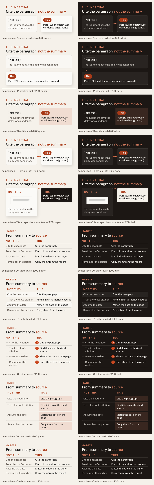

| Variant | Slots | 1200 | 720 |
|---|---|---|---|
| Comparison 1 — side-by-side-link | `kicker`, `title_html`, `left_label`, `left_text`, `right_label`, `right_text` | [html](graphics/comparison-01-side-by-side-link-1200.html) · [paper](previews/graphics/comparison-01-side-by-side-link-1200-paper.png) · [dark](previews/graphics/comparison-01-side-by-side-link-1200-dark.png) | [html](graphics/comparison-01-side-by-side-link-720.html) · [paper](previews/graphics/comparison-01-side-by-side-link-720-paper.png) · [dark](previews/graphics/comparison-01-side-by-side-link-720-dark.png) |
| Comparison 2 — stacked-link | `kicker`, `title_html`, `left_label`, `left_text`, `right_label`, `right_text` | [html](graphics/comparison-02-stacked-link-1200.html) · [paper](previews/graphics/comparison-02-stacked-link-1200-paper.png) · [dark](previews/graphics/comparison-02-stacked-link-1200-dark.png) | [html](graphics/comparison-02-stacked-link-720.html) · [paper](previews/graphics/comparison-02-stacked-link-720-paper.png) · [dark](previews/graphics/comparison-02-stacked-link-720-dark.png) |
| Comparison 3 — split-panel | `kicker`, `title_html`, `left_label`, `left_text`, `right_label`, `right_text` | [html](graphics/comparison-03-split-panel-1200.html) · [paper](previews/graphics/comparison-03-split-panel-1200-paper.png) · [dark](previews/graphics/comparison-03-split-panel-1200-dark.png) | [html](graphics/comparison-03-split-panel-720.html) · [paper](previews/graphics/comparison-03-split-panel-720-paper.png) · [dark](previews/graphics/comparison-03-split-panel-720-dark.png) |
| Comparison 4 — struck-left | `kicker`, `title_html`, `left_label`, `left_text`, `right_label`, `right_text` | [html](graphics/comparison-04-struck-left-1200.html) · [paper](previews/graphics/comparison-04-struck-left-1200-paper.png) · [dark](previews/graphics/comparison-04-struck-left-1200-dark.png) | [html](graphics/comparison-04-struck-left-720.html) · [paper](previews/graphics/comparison-04-struck-left-720-paper.png) · [dark](previews/graphics/comparison-04-struck-left-720-dark.png) |
| Comparison 5 — paragraph-and-sentence | `kicker`, `title_html`, `left_label`, `left_text`, `right_label`, `right_text` | [html](graphics/comparison-05-paragraph-and-sentence-1200.html) · [paper](previews/graphics/comparison-05-paragraph-and-sentence-1200-paper.png) · [dark](previews/graphics/comparison-05-paragraph-and-sentence-1200-dark.png) | [html](graphics/comparison-05-paragraph-and-sentence-720.html) · [paper](previews/graphics/comparison-05-paragraph-and-sentence-720-paper.png) · [dark](previews/graphics/comparison-05-paragraph-and-sentence-720-dark.png) |
| Comparison 6 — table-plain | `kicker`, `title_html`, `left_label`, `right_label`, `rows` | [html](graphics/comparison-06-table-plain-1200.html) · [paper](previews/graphics/comparison-06-table-plain-1200-paper.png) · [dark](previews/graphics/comparison-06-table-plain-1200-dark.png) | [html](graphics/comparison-06-table-plain-720.html) · [paper](previews/graphics/comparison-06-table-plain-720-paper.png) · [dark](previews/graphics/comparison-06-table-plain-720-dark.png) |
| Comparison 7 — table-banded | `kicker`, `title_html`, `left_label`, `right_label`, `rows` | [html](graphics/comparison-07-table-banded-1200.html) · [paper](previews/graphics/comparison-07-table-banded-1200-paper.png) · [dark](previews/graphics/comparison-07-table-banded-1200-dark.png) | [html](graphics/comparison-07-table-banded-720.html) · [paper](previews/graphics/comparison-07-table-banded-720-paper.png) · [dark](previews/graphics/comparison-07-table-banded-720-dark.png) |
| Comparison 8 — table-marks | `kicker`, `title_html`, `left_label`, `right_label`, `rows` | [html](graphics/comparison-08-table-marks-1200.html) · [paper](previews/graphics/comparison-08-table-marks-1200-paper.png) · [dark](previews/graphics/comparison-08-table-marks-1200-dark.png) | [html](graphics/comparison-08-table-marks-720.html) · [paper](previews/graphics/comparison-08-table-marks-720-paper.png) · [dark](previews/graphics/comparison-08-table-marks-720-dark.png) |
| Comparison 9 — row-cards | `kicker`, `title_html`, `left_label`, `right_label`, `rows` | [html](graphics/comparison-09-row-cards-1200.html) · [paper](previews/graphics/comparison-09-row-cards-1200-paper.png) · [dark](previews/graphics/comparison-09-row-cards-1200-dark.png) | [html](graphics/comparison-09-row-cards-720.html) · [paper](previews/graphics/comparison-09-row-cards-720-paper.png) · [dark](previews/graphics/comparison-09-row-cards-720-dark.png) |
| Comparison 10 — table-compact | `kicker`, `title_html`, `left_label`, `right_label`, `rows` | [html](graphics/comparison-10-table-compact-1200.html) · [paper](previews/graphics/comparison-10-table-compact-1200-paper.png) · [dark](previews/graphics/comparison-10-table-compact-1200-dark.png) | [html](graphics/comparison-10-table-compact-720.html) · [paper](previews/graphics/comparison-10-table-compact-720-paper.png) · [dark](previews/graphics/comparison-10-table-compact-720-dark.png) |

Mobile sheet: [previews/graphics-comparison-720-contact-sheet.png](previews/graphics-comparison-720-contact-sheet.png). Schemas: `graphics/comparison-NN-*.schema.json`.

### Timeline

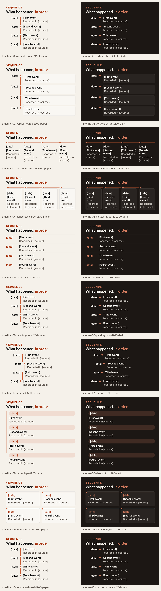

| Variant | Slots | 1200 | 720 |
|---|---|---|---|
| Timeline 1 — vertical-thread | `kicker`, `title_html`, `events` | [html](graphics/timeline-01-vertical-thread-1200.html) · [paper](previews/graphics/timeline-01-vertical-thread-1200-paper.png) · [dark](previews/graphics/timeline-01-vertical-thread-1200-dark.png) | [html](graphics/timeline-01-vertical-thread-720.html) · [paper](previews/graphics/timeline-01-vertical-thread-720-paper.png) · [dark](previews/graphics/timeline-01-vertical-thread-720-dark.png) |
| Timeline 2 — vertical-cards | `kicker`, `title_html`, `events` | [html](graphics/timeline-02-vertical-cards-1200.html) · [paper](previews/graphics/timeline-02-vertical-cards-1200-paper.png) · [dark](previews/graphics/timeline-02-vertical-cards-1200-dark.png) | [html](graphics/timeline-02-vertical-cards-720.html) · [paper](previews/graphics/timeline-02-vertical-cards-720-paper.png) · [dark](previews/graphics/timeline-02-vertical-cards-720-dark.png) |
| Timeline 3 — horizontal-thread | `kicker`, `title_html`, `events` | [html](graphics/timeline-03-horizontal-thread-1200.html) · [paper](previews/graphics/timeline-03-horizontal-thread-1200-paper.png) · [dark](previews/graphics/timeline-03-horizontal-thread-1200-dark.png) | [html](graphics/timeline-03-horizontal-thread-720.html) · [paper](previews/graphics/timeline-03-horizontal-thread-720-paper.png) · [dark](previews/graphics/timeline-03-horizontal-thread-720-dark.png) |
| Timeline 4 — horizontal-cards | `kicker`, `title_html`, `events` | [html](graphics/timeline-04-horizontal-cards-1200.html) · [paper](previews/graphics/timeline-04-horizontal-cards-1200-paper.png) · [dark](previews/graphics/timeline-04-horizontal-cards-1200-dark.png) | [html](graphics/timeline-04-horizontal-cards-720.html) · [paper](previews/graphics/timeline-04-horizontal-cards-720-paper.png) · [dark](previews/graphics/timeline-04-horizontal-cards-720-dark.png) |
| Timeline 5 — dated-list | `kicker`, `title_html`, `events` | [html](graphics/timeline-05-dated-list-1200.html) · [paper](previews/graphics/timeline-05-dated-list-1200-paper.png) · [dark](previews/graphics/timeline-05-dated-list-1200-dark.png) | [html](graphics/timeline-05-dated-list-720.html) · [paper](previews/graphics/timeline-05-dated-list-720-paper.png) · [dark](previews/graphics/timeline-05-dated-list-720-dark.png) |
| Timeline 6 — pending-last | `kicker`, `title_html`, `events` | [html](graphics/timeline-06-pending-last-1200.html) · [paper](previews/graphics/timeline-06-pending-last-1200-paper.png) · [dark](previews/graphics/timeline-06-pending-last-1200-dark.png) | [html](graphics/timeline-06-pending-last-720.html) · [paper](previews/graphics/timeline-06-pending-last-720-paper.png) · [dark](previews/graphics/timeline-06-pending-last-720-dark.png) |
| Timeline 7 — stepped | `kicker`, `title_html`, `events` | [html](graphics/timeline-07-stepped-1200.html) · [paper](previews/graphics/timeline-07-stepped-1200-paper.png) · [dark](previews/graphics/timeline-07-stepped-1200-dark.png) | [html](graphics/timeline-07-stepped-720.html) · [paper](previews/graphics/timeline-07-stepped-720-paper.png) · [dark](previews/graphics/timeline-07-stepped-720-dark.png) |
| Timeline 8 — date-chips | `kicker`, `title_html`, `events` | [html](graphics/timeline-08-date-chips-1200.html) · [paper](previews/graphics/timeline-08-date-chips-1200-paper.png) · [dark](previews/graphics/timeline-08-date-chips-1200-dark.png) | [html](graphics/timeline-08-date-chips-720.html) · [paper](previews/graphics/timeline-08-date-chips-720-paper.png) · [dark](previews/graphics/timeline-08-date-chips-720-dark.png) |
| Timeline 9 — milestone-grid | `kicker`, `title_html`, `events` | [html](graphics/timeline-09-milestone-grid-1200.html) · [paper](previews/graphics/timeline-09-milestone-grid-1200-paper.png) · [dark](previews/graphics/timeline-09-milestone-grid-1200-dark.png) | [html](graphics/timeline-09-milestone-grid-720.html) · [paper](previews/graphics/timeline-09-milestone-grid-720-paper.png) · [dark](previews/graphics/timeline-09-milestone-grid-720-dark.png) |
| Timeline 10 — compact-thread | `kicker`, `title_html`, `events` | [html](graphics/timeline-10-compact-thread-1200.html) · [paper](previews/graphics/timeline-10-compact-thread-1200-paper.png) · [dark](previews/graphics/timeline-10-compact-thread-1200-dark.png) | [html](graphics/timeline-10-compact-thread-720.html) · [paper](previews/graphics/timeline-10-compact-thread-720-paper.png) · [dark](previews/graphics/timeline-10-compact-thread-720-dark.png) |

Mobile sheet: [previews/graphics-timeline-720-contact-sheet.png](previews/graphics-timeline-720-contact-sheet.png). Schemas: `graphics/timeline-NN-*.schema.json`.

### Document callouts

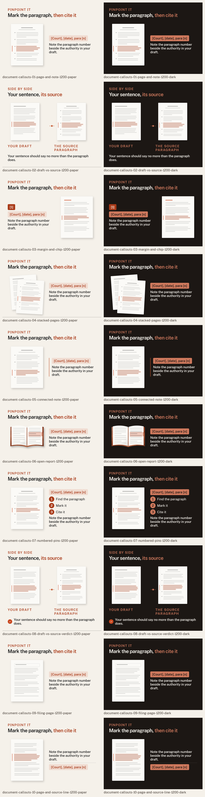

| Variant | Slots | 1200 | 720 |
|---|---|---|---|
| Document callout 1 — page-and-note | `kicker`, `title_html`, `pinpoint`, `callout` | [html](graphics/document-callouts-01-page-and-note-1200.html) · [paper](previews/graphics/document-callouts-01-page-and-note-1200-paper.png) · [dark](previews/graphics/document-callouts-01-page-and-note-1200-dark.png) | [html](graphics/document-callouts-01-page-and-note-720.html) · [paper](previews/graphics/document-callouts-01-page-and-note-720-paper.png) · [dark](previews/graphics/document-callouts-01-page-and-note-720-dark.png) |
| Document callout 2 — draft-vs-source | `kicker`, `title_html`, `draft_label`, `source_label`, `callout` | [html](graphics/document-callouts-02-draft-vs-source-1200.html) · [paper](previews/graphics/document-callouts-02-draft-vs-source-1200-paper.png) · [dark](previews/graphics/document-callouts-02-draft-vs-source-1200-dark.png) | [html](graphics/document-callouts-02-draft-vs-source-720.html) · [paper](previews/graphics/document-callouts-02-draft-vs-source-720-paper.png) · [dark](previews/graphics/document-callouts-02-draft-vs-source-720-dark.png) |
| Document callout 3 — margin-and-chip | `kicker`, `title_html`, `pinpoint`, `callout` | [html](graphics/document-callouts-03-margin-and-chip-1200.html) · [paper](previews/graphics/document-callouts-03-margin-and-chip-1200-paper.png) · [dark](previews/graphics/document-callouts-03-margin-and-chip-1200-dark.png) | [html](graphics/document-callouts-03-margin-and-chip-720.html) · [paper](previews/graphics/document-callouts-03-margin-and-chip-720-paper.png) · [dark](previews/graphics/document-callouts-03-margin-and-chip-720-dark.png) |
| Document callout 4 — stacked-pages | `kicker`, `title_html`, `pinpoint`, `callout` | [html](graphics/document-callouts-04-stacked-pages-1200.html) · [paper](previews/graphics/document-callouts-04-stacked-pages-1200-paper.png) · [dark](previews/graphics/document-callouts-04-stacked-pages-1200-dark.png) | [html](graphics/document-callouts-04-stacked-pages-720.html) · [paper](previews/graphics/document-callouts-04-stacked-pages-720-paper.png) · [dark](previews/graphics/document-callouts-04-stacked-pages-720-dark.png) |
| Document callout 5 — connected-note | `kicker`, `title_html`, `pinpoint`, `callout` | [html](graphics/document-callouts-05-connected-note-1200.html) · [paper](previews/graphics/document-callouts-05-connected-note-1200-paper.png) · [dark](previews/graphics/document-callouts-05-connected-note-1200-dark.png) | [html](graphics/document-callouts-05-connected-note-720.html) · [paper](previews/graphics/document-callouts-05-connected-note-720-paper.png) · [dark](previews/graphics/document-callouts-05-connected-note-720-dark.png) |
| Document callout 6 — open-report | `kicker`, `title_html`, `pinpoint`, `callout` | [html](graphics/document-callouts-06-open-report-1200.html) · [paper](previews/graphics/document-callouts-06-open-report-1200-paper.png) · [dark](previews/graphics/document-callouts-06-open-report-1200-dark.png) | [html](graphics/document-callouts-06-open-report-720.html) · [paper](previews/graphics/document-callouts-06-open-report-720-paper.png) · [dark](previews/graphics/document-callouts-06-open-report-720-dark.png) |
| Document callout 7 — numbered-pins | `kicker`, `title_html`, `pinpoint`, `callout`, `pins` | [html](graphics/document-callouts-07-numbered-pins-1200.html) · [paper](previews/graphics/document-callouts-07-numbered-pins-1200-paper.png) · [dark](previews/graphics/document-callouts-07-numbered-pins-1200-dark.png) | [html](graphics/document-callouts-07-numbered-pins-720.html) · [paper](previews/graphics/document-callouts-07-numbered-pins-720-paper.png) · [dark](previews/graphics/document-callouts-07-numbered-pins-720-dark.png) |
| Document callout 8 — draft-vs-source-verdict | `kicker`, `title_html`, `draft_label`, `source_label`, `callout` | [html](graphics/document-callouts-08-draft-vs-source-verdict-1200.html) · [paper](previews/graphics/document-callouts-08-draft-vs-source-verdict-1200-paper.png) · [dark](previews/graphics/document-callouts-08-draft-vs-source-verdict-1200-dark.png) | [html](graphics/document-callouts-08-draft-vs-source-verdict-720.html) · [paper](previews/graphics/document-callouts-08-draft-vs-source-verdict-720-paper.png) · [dark](previews/graphics/document-callouts-08-draft-vs-source-verdict-720-dark.png) |
| Document callout 9 — filing-page | `kicker`, `title_html`, `pinpoint`, `callout` | [html](graphics/document-callouts-09-filing-page-1200.html) · [paper](previews/graphics/document-callouts-09-filing-page-1200-paper.png) · [dark](previews/graphics/document-callouts-09-filing-page-1200-dark.png) | [html](graphics/document-callouts-09-filing-page-720.html) · [paper](previews/graphics/document-callouts-09-filing-page-720-paper.png) · [dark](previews/graphics/document-callouts-09-filing-page-720-dark.png) |
| Document callout 10 — page-and-source-line | `kicker`, `title_html`, `pinpoint`, `callout` | [html](graphics/document-callouts-10-page-and-source-line-1200.html) · [paper](previews/graphics/document-callouts-10-page-and-source-line-1200-paper.png) · [dark](previews/graphics/document-callouts-10-page-and-source-line-1200-dark.png) | [html](graphics/document-callouts-10-page-and-source-line-720.html) · [paper](previews/graphics/document-callouts-10-page-and-source-line-720-paper.png) · [dark](previews/graphics/document-callouts-10-page-and-source-line-720-dark.png) |

Mobile sheet: [previews/graphics-document-callouts-720-contact-sheet.png](previews/graphics-document-callouts-720-contact-sheet.png). Schemas: `graphics/document-callouts-NN-*.schema.json`.

### Definition and key-term boxes

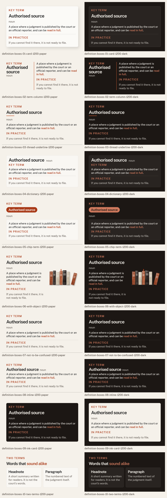

| Variant | Slots | 1200 | 720 |
|---|---|---|---|
| Definition box 1 — card | `label`, `term`, `pos`, `meaning_html`, `note_label`, `note` | [html](graphics/definition-boxes-01-card-1200.html) · [paper](previews/graphics/definition-boxes-01-card-1200-paper.png) · [dark](previews/graphics/definition-boxes-01-card-1200-dark.png) | [html](graphics/definition-boxes-01-card-720.html) · [paper](previews/graphics/definition-boxes-01-card-720-paper.png) · [dark](previews/graphics/definition-boxes-01-card-720-dark.png) |
| Definition box 2 — term-column | `label`, `term`, `pos`, `meaning_html`, `note_label`, `note` | [html](graphics/definition-boxes-02-term-column-1200.html) · [paper](previews/graphics/definition-boxes-02-term-column-1200-paper.png) · [dark](previews/graphics/definition-boxes-02-term-column-1200-dark.png) | [html](graphics/definition-boxes-02-term-column-720.html) · [paper](previews/graphics/definition-boxes-02-term-column-720-paper.png) · [dark](previews/graphics/definition-boxes-02-term-column-720-dark.png) |
| Definition box 3 — thread-underline | `label`, `term`, `pos`, `meaning_html`, `note_label`, `note` | [html](graphics/definition-boxes-03-thread-underline-1200.html) · [paper](previews/graphics/definition-boxes-03-thread-underline-1200-paper.png) · [dark](previews/graphics/definition-boxes-03-thread-underline-1200-dark.png) | [html](graphics/definition-boxes-03-thread-underline-720.html) · [paper](previews/graphics/definition-boxes-03-thread-underline-720-paper.png) · [dark](previews/graphics/definition-boxes-03-thread-underline-720-dark.png) |
| Definition box 4 — dictionary | `label`, `term`, `pos`, `meaning_html`, `note_label`, `note` | [html](graphics/definition-boxes-04-dictionary-1200.html) · [paper](previews/graphics/definition-boxes-04-dictionary-1200-paper.png) · [dark](previews/graphics/definition-boxes-04-dictionary-1200-dark.png) | [html](graphics/definition-boxes-04-dictionary-720.html) · [paper](previews/graphics/definition-boxes-04-dictionary-720-paper.png) · [dark](previews/graphics/definition-boxes-04-dictionary-720-dark.png) |
| Definition box 5 — chip-term | `label`, `term`, `pos`, `meaning_html`, `note_label`, `note` | [html](graphics/definition-boxes-05-chip-term-1200.html) · [paper](previews/graphics/definition-boxes-05-chip-term-1200-paper.png) · [dark](previews/graphics/definition-boxes-05-chip-term-1200-dark.png) | [html](graphics/definition-boxes-05-chip-term-720.html) · [paper](previews/graphics/definition-boxes-05-chip-term-720-paper.png) · [dark](previews/graphics/definition-boxes-05-chip-term-720-dark.png) |
| Definition box 6 — with-object | `label`, `term`, `pos`, `meaning_html`, `note_label`, `note` | [html](graphics/definition-boxes-06-with-object-1200.html) · [paper](previews/graphics/definition-boxes-06-with-object-1200-paper.png) · [dark](previews/graphics/definition-boxes-06-with-object-1200-dark.png) | [html](graphics/definition-boxes-06-with-object-720.html) · [paper](previews/graphics/definition-boxes-06-with-object-720-paper.png) · [dark](previews/graphics/definition-boxes-06-with-object-720-dark.png) |
| Definition box 7 — not-to-be-confused | `label`, `term`, `pos`, `meaning_html`, `note_label`, `note` | [html](graphics/definition-boxes-07-not-to-be-confused-1200.html) · [paper](previews/graphics/definition-boxes-07-not-to-be-confused-1200-paper.png) · [dark](previews/graphics/definition-boxes-07-not-to-be-confused-1200-dark.png) | [html](graphics/definition-boxes-07-not-to-be-confused-720.html) · [paper](previews/graphics/definition-boxes-07-not-to-be-confused-720-paper.png) · [dark](previews/graphics/definition-boxes-07-not-to-be-confused-720-dark.png) |
| Definition box 8 — inline | `label`, `term`, `pos`, `meaning_html`, `note_label`, `note` | [html](graphics/definition-boxes-08-inline-1200.html) · [paper](previews/graphics/definition-boxes-08-inline-1200-paper.png) · [dark](previews/graphics/definition-boxes-08-inline-1200-dark.png) | [html](graphics/definition-boxes-08-inline-720.html) · [paper](previews/graphics/definition-boxes-08-inline-720-paper.png) · [dark](previews/graphics/definition-boxes-08-inline-720-dark.png) |
| Definition box 9 — ink-card | `label`, `term`, `pos`, `meaning_html`, `note_label`, `note` | [html](graphics/definition-boxes-09-ink-card-1200.html) · [paper](previews/graphics/definition-boxes-09-ink-card-1200-paper.png) · [dark](previews/graphics/definition-boxes-09-ink-card-1200-dark.png) | [html](graphics/definition-boxes-09-ink-card-720.html) · [paper](previews/graphics/definition-boxes-09-ink-card-720-paper.png) · [dark](previews/graphics/definition-boxes-09-ink-card-720-dark.png) |
| Definition box 10 — two-terms | `kicker`, `title_html`, `terms` | [html](graphics/definition-boxes-10-two-terms-1200.html) · [paper](previews/graphics/definition-boxes-10-two-terms-1200-paper.png) · [dark](previews/graphics/definition-boxes-10-two-terms-1200-dark.png) | [html](graphics/definition-boxes-10-two-terms-720.html) · [paper](previews/graphics/definition-boxes-10-two-terms-720-paper.png) · [dark](previews/graphics/definition-boxes-10-two-terms-720-dark.png) |

Mobile sheet: [previews/graphics-definition-boxes-720-contact-sheet.png](previews/graphics-definition-boxes-720-contact-sheet.png). Schemas: `graphics/definition-boxes-NN-*.schema.json`.

### Callout and note boxes

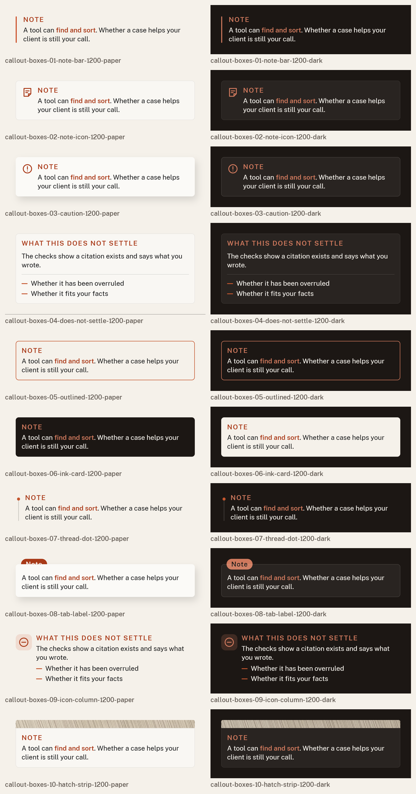

| Variant | Slots | 1200 | 720 |
|---|---|---|---|
| Callout box 1 — note-bar | `label`, `body_html` | [html](graphics/callout-boxes-01-note-bar-1200.html) · [paper](previews/graphics/callout-boxes-01-note-bar-1200-paper.png) · [dark](previews/graphics/callout-boxes-01-note-bar-1200-dark.png) | [html](graphics/callout-boxes-01-note-bar-720.html) · [paper](previews/graphics/callout-boxes-01-note-bar-720-paper.png) · [dark](previews/graphics/callout-boxes-01-note-bar-720-dark.png) |
| Callout box 2 — note-icon | `label`, `body_html` | [html](graphics/callout-boxes-02-note-icon-1200.html) · [paper](previews/graphics/callout-boxes-02-note-icon-1200-paper.png) · [dark](previews/graphics/callout-boxes-02-note-icon-1200-dark.png) | [html](graphics/callout-boxes-02-note-icon-720.html) · [paper](previews/graphics/callout-boxes-02-note-icon-720-paper.png) · [dark](previews/graphics/callout-boxes-02-note-icon-720-dark.png) |
| Callout box 3 — caution | `label`, `body_html` | [html](graphics/callout-boxes-03-caution-1200.html) · [paper](previews/graphics/callout-boxes-03-caution-1200-paper.png) · [dark](previews/graphics/callout-boxes-03-caution-1200-dark.png) | [html](graphics/callout-boxes-03-caution-720.html) · [paper](previews/graphics/callout-boxes-03-caution-720-paper.png) · [dark](previews/graphics/callout-boxes-03-caution-720-dark.png) |
| Callout box 4 — does-not-settle | `label`, `body_html`, `rows` | [html](graphics/callout-boxes-04-does-not-settle-1200.html) · [paper](previews/graphics/callout-boxes-04-does-not-settle-1200-paper.png) · [dark](previews/graphics/callout-boxes-04-does-not-settle-1200-dark.png) | [html](graphics/callout-boxes-04-does-not-settle-720.html) · [paper](previews/graphics/callout-boxes-04-does-not-settle-720-paper.png) · [dark](previews/graphics/callout-boxes-04-does-not-settle-720-dark.png) |
| Callout box 5 — outlined | `label`, `body_html` | [html](graphics/callout-boxes-05-outlined-1200.html) · [paper](previews/graphics/callout-boxes-05-outlined-1200-paper.png) · [dark](previews/graphics/callout-boxes-05-outlined-1200-dark.png) | [html](graphics/callout-boxes-05-outlined-720.html) · [paper](previews/graphics/callout-boxes-05-outlined-720-paper.png) · [dark](previews/graphics/callout-boxes-05-outlined-720-dark.png) |
| Callout box 6 — ink-card | `label`, `body_html` | [html](graphics/callout-boxes-06-ink-card-1200.html) · [paper](previews/graphics/callout-boxes-06-ink-card-1200-paper.png) · [dark](previews/graphics/callout-boxes-06-ink-card-1200-dark.png) | [html](graphics/callout-boxes-06-ink-card-720.html) · [paper](previews/graphics/callout-boxes-06-ink-card-720-paper.png) · [dark](previews/graphics/callout-boxes-06-ink-card-720-dark.png) |
| Callout box 7 — thread-dot | `label`, `body_html` | [html](graphics/callout-boxes-07-thread-dot-1200.html) · [paper](previews/graphics/callout-boxes-07-thread-dot-1200-paper.png) · [dark](previews/graphics/callout-boxes-07-thread-dot-1200-dark.png) | [html](graphics/callout-boxes-07-thread-dot-720.html) · [paper](previews/graphics/callout-boxes-07-thread-dot-720-paper.png) · [dark](previews/graphics/callout-boxes-07-thread-dot-720-dark.png) |
| Callout box 8 — tab-label | `label`, `body_html` | [html](graphics/callout-boxes-08-tab-label-1200.html) · [paper](previews/graphics/callout-boxes-08-tab-label-1200-paper.png) · [dark](previews/graphics/callout-boxes-08-tab-label-1200-dark.png) | [html](graphics/callout-boxes-08-tab-label-720.html) · [paper](previews/graphics/callout-boxes-08-tab-label-720-paper.png) · [dark](previews/graphics/callout-boxes-08-tab-label-720-dark.png) |
| Callout box 9 — icon-column | `label`, `body_html`, `rows` | [html](graphics/callout-boxes-09-icon-column-1200.html) · [paper](previews/graphics/callout-boxes-09-icon-column-1200-paper.png) · [dark](previews/graphics/callout-boxes-09-icon-column-1200-dark.png) | [html](graphics/callout-boxes-09-icon-column-720.html) · [paper](previews/graphics/callout-boxes-09-icon-column-720-paper.png) · [dark](previews/graphics/callout-boxes-09-icon-column-720-dark.png) |
| Callout box 10 — hatch-strip | `label`, `body_html` | [html](graphics/callout-boxes-10-hatch-strip-1200.html) · [paper](previews/graphics/callout-boxes-10-hatch-strip-1200-paper.png) · [dark](previews/graphics/callout-boxes-10-hatch-strip-1200-dark.png) | [html](graphics/callout-boxes-10-hatch-strip-720.html) · [paper](previews/graphics/callout-boxes-10-hatch-strip-720-paper.png) · [dark](previews/graphics/callout-boxes-10-hatch-strip-720-dark.png) |

Mobile sheet: [previews/graphics-callout-boxes-720-contact-sheet.png](previews/graphics-callout-boxes-720-contact-sheet.png). Schemas: `graphics/callout-boxes-NN-*.schema.json`.

### Pull statements

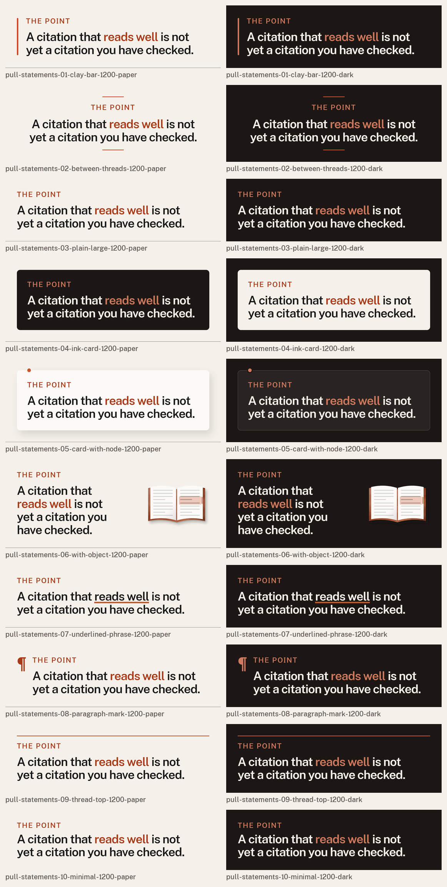

| Variant | Slots | 1200 | 720 |
|---|---|---|---|
| Pull statement 1 — clay-bar | `kicker`, `statement_html` | [html](graphics/pull-statements-01-clay-bar-1200.html) · [paper](previews/graphics/pull-statements-01-clay-bar-1200-paper.png) · [dark](previews/graphics/pull-statements-01-clay-bar-1200-dark.png) | [html](graphics/pull-statements-01-clay-bar-720.html) · [paper](previews/graphics/pull-statements-01-clay-bar-720-paper.png) · [dark](previews/graphics/pull-statements-01-clay-bar-720-dark.png) |
| Pull statement 2 — between-threads | `kicker`, `statement_html` | [html](graphics/pull-statements-02-between-threads-1200.html) · [paper](previews/graphics/pull-statements-02-between-threads-1200-paper.png) · [dark](previews/graphics/pull-statements-02-between-threads-1200-dark.png) | [html](graphics/pull-statements-02-between-threads-720.html) · [paper](previews/graphics/pull-statements-02-between-threads-720-paper.png) · [dark](previews/graphics/pull-statements-02-between-threads-720-dark.png) |
| Pull statement 3 — plain-large | `kicker`, `statement_html` | [html](graphics/pull-statements-03-plain-large-1200.html) · [paper](previews/graphics/pull-statements-03-plain-large-1200-paper.png) · [dark](previews/graphics/pull-statements-03-plain-large-1200-dark.png) | [html](graphics/pull-statements-03-plain-large-720.html) · [paper](previews/graphics/pull-statements-03-plain-large-720-paper.png) · [dark](previews/graphics/pull-statements-03-plain-large-720-dark.png) |
| Pull statement 4 — ink-card | `kicker`, `statement_html` | [html](graphics/pull-statements-04-ink-card-1200.html) · [paper](previews/graphics/pull-statements-04-ink-card-1200-paper.png) · [dark](previews/graphics/pull-statements-04-ink-card-1200-dark.png) | [html](graphics/pull-statements-04-ink-card-720.html) · [paper](previews/graphics/pull-statements-04-ink-card-720-paper.png) · [dark](previews/graphics/pull-statements-04-ink-card-720-dark.png) |
| Pull statement 5 — card-with-node | `kicker`, `statement_html` | [html](graphics/pull-statements-05-card-with-node-1200.html) · [paper](previews/graphics/pull-statements-05-card-with-node-1200-paper.png) · [dark](previews/graphics/pull-statements-05-card-with-node-1200-dark.png) | [html](graphics/pull-statements-05-card-with-node-720.html) · [paper](previews/graphics/pull-statements-05-card-with-node-720-paper.png) · [dark](previews/graphics/pull-statements-05-card-with-node-720-dark.png) |
| Pull statement 6 — with-object | `kicker`, `statement_html`, `motif` | [html](graphics/pull-statements-06-with-object-1200.html) · [paper](previews/graphics/pull-statements-06-with-object-1200-paper.png) · [dark](previews/graphics/pull-statements-06-with-object-1200-dark.png) | [html](graphics/pull-statements-06-with-object-720.html) · [paper](previews/graphics/pull-statements-06-with-object-720-paper.png) · [dark](previews/graphics/pull-statements-06-with-object-720-dark.png) |
| Pull statement 7 — underlined-phrase | `kicker`, `statement_html` | [html](graphics/pull-statements-07-underlined-phrase-1200.html) · [paper](previews/graphics/pull-statements-07-underlined-phrase-1200-paper.png) · [dark](previews/graphics/pull-statements-07-underlined-phrase-1200-dark.png) | [html](graphics/pull-statements-07-underlined-phrase-720.html) · [paper](previews/graphics/pull-statements-07-underlined-phrase-720-paper.png) · [dark](previews/graphics/pull-statements-07-underlined-phrase-720-dark.png) |
| Pull statement 8 — paragraph-mark | `kicker`, `statement_html` | [html](graphics/pull-statements-08-paragraph-mark-1200.html) · [paper](previews/graphics/pull-statements-08-paragraph-mark-1200-paper.png) · [dark](previews/graphics/pull-statements-08-paragraph-mark-1200-dark.png) | [html](graphics/pull-statements-08-paragraph-mark-720.html) · [paper](previews/graphics/pull-statements-08-paragraph-mark-720-paper.png) · [dark](previews/graphics/pull-statements-08-paragraph-mark-720-dark.png) |
| Pull statement 9 — thread-top | `kicker`, `statement_html` | [html](graphics/pull-statements-09-thread-top-1200.html) · [paper](previews/graphics/pull-statements-09-thread-top-1200-paper.png) · [dark](previews/graphics/pull-statements-09-thread-top-1200-dark.png) | [html](graphics/pull-statements-09-thread-top-720.html) · [paper](previews/graphics/pull-statements-09-thread-top-720-paper.png) · [dark](previews/graphics/pull-statements-09-thread-top-720-dark.png) |
| Pull statement 10 — minimal | `kicker`, `statement_html` | [html](graphics/pull-statements-10-minimal-1200.html) · [paper](previews/graphics/pull-statements-10-minimal-1200-paper.png) · [dark](previews/graphics/pull-statements-10-minimal-1200-dark.png) | [html](graphics/pull-statements-10-minimal-720.html) · [paper](previews/graphics/pull-statements-10-minimal-720-paper.png) · [dark](previews/graphics/pull-statements-10-minimal-720-dark.png) |

Mobile sheet: [previews/graphics-pull-statements-720-contact-sheet.png](previews/graphics-pull-statements-720-contact-sheet.png). Schemas: `graphics/pull-statements-NN-*.schema.json`.

### Source and citation lines

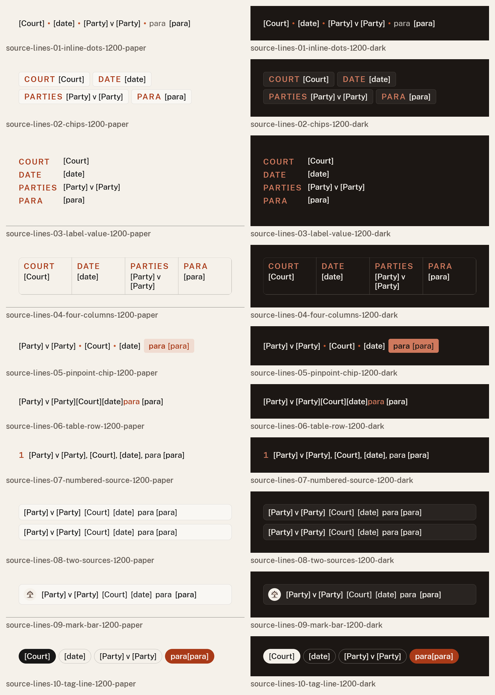

| Variant | Slots | 1200 | 720 |
|---|---|---|---|
| Source line 1 — inline-dots | `court`, `date`, `parties`, `para` | [html](graphics/source-lines-01-inline-dots-1200.html) · [paper](previews/graphics/source-lines-01-inline-dots-1200-paper.png) · [dark](previews/graphics/source-lines-01-inline-dots-1200-dark.png) | [html](graphics/source-lines-01-inline-dots-720.html) · [paper](previews/graphics/source-lines-01-inline-dots-720-paper.png) · [dark](previews/graphics/source-lines-01-inline-dots-720-dark.png) |
| Source line 2 — chips | `court`, `date`, `parties`, `para` | [html](graphics/source-lines-02-chips-1200.html) · [paper](previews/graphics/source-lines-02-chips-1200-paper.png) · [dark](previews/graphics/source-lines-02-chips-1200-dark.png) | [html](graphics/source-lines-02-chips-720.html) · [paper](previews/graphics/source-lines-02-chips-720-paper.png) · [dark](previews/graphics/source-lines-02-chips-720-dark.png) |
| Source line 3 — label-value | `court`, `date`, `parties`, `para` | [html](graphics/source-lines-03-label-value-1200.html) · [paper](previews/graphics/source-lines-03-label-value-1200-paper.png) · [dark](previews/graphics/source-lines-03-label-value-1200-dark.png) | [html](graphics/source-lines-03-label-value-720.html) · [paper](previews/graphics/source-lines-03-label-value-720-paper.png) · [dark](previews/graphics/source-lines-03-label-value-720-dark.png) |
| Source line 4 — four-columns | `court`, `date`, `parties`, `para` | [html](graphics/source-lines-04-four-columns-1200.html) · [paper](previews/graphics/source-lines-04-four-columns-1200-paper.png) · [dark](previews/graphics/source-lines-04-four-columns-1200-dark.png) | [html](graphics/source-lines-04-four-columns-720.html) · [paper](previews/graphics/source-lines-04-four-columns-720-paper.png) · [dark](previews/graphics/source-lines-04-four-columns-720-dark.png) |
| Source line 5 — pinpoint-chip | `court`, `date`, `parties`, `para` | [html](graphics/source-lines-05-pinpoint-chip-1200.html) · [paper](previews/graphics/source-lines-05-pinpoint-chip-1200-paper.png) · [dark](previews/graphics/source-lines-05-pinpoint-chip-1200-dark.png) | [html](graphics/source-lines-05-pinpoint-chip-720.html) · [paper](previews/graphics/source-lines-05-pinpoint-chip-720-paper.png) · [dark](previews/graphics/source-lines-05-pinpoint-chip-720-dark.png) |
| Source line 6 — table-row | `court`, `date`, `parties`, `para` | [html](graphics/source-lines-06-table-row-1200.html) · [paper](previews/graphics/source-lines-06-table-row-1200-paper.png) · [dark](previews/graphics/source-lines-06-table-row-1200-dark.png) | [html](graphics/source-lines-06-table-row-720.html) · [paper](previews/graphics/source-lines-06-table-row-720-paper.png) · [dark](previews/graphics/source-lines-06-table-row-720-dark.png) |
| Source line 7 — numbered-source | `court`, `date`, `parties`, `para` | [html](graphics/source-lines-07-numbered-source-1200.html) · [paper](previews/graphics/source-lines-07-numbered-source-1200-paper.png) · [dark](previews/graphics/source-lines-07-numbered-source-1200-dark.png) | [html](graphics/source-lines-07-numbered-source-720.html) · [paper](previews/graphics/source-lines-07-numbered-source-720-paper.png) · [dark](previews/graphics/source-lines-07-numbered-source-720-dark.png) |
| Source line 8 — two-sources | `sources` | [html](graphics/source-lines-08-two-sources-1200.html) · [paper](previews/graphics/source-lines-08-two-sources-1200-paper.png) · [dark](previews/graphics/source-lines-08-two-sources-1200-dark.png) | [html](graphics/source-lines-08-two-sources-720.html) · [paper](previews/graphics/source-lines-08-two-sources-720-paper.png) · [dark](previews/graphics/source-lines-08-two-sources-720-dark.png) |
| Source line 9 — mark-bar | `court`, `date`, `parties`, `para` | [html](graphics/source-lines-09-mark-bar-1200.html) · [paper](previews/graphics/source-lines-09-mark-bar-1200-paper.png) · [dark](previews/graphics/source-lines-09-mark-bar-1200-dark.png) | [html](graphics/source-lines-09-mark-bar-720.html) · [paper](previews/graphics/source-lines-09-mark-bar-720-paper.png) · [dark](previews/graphics/source-lines-09-mark-bar-720-dark.png) |
| Source line 10 — tag-line | `court`, `date`, `parties`, `para` | [html](graphics/source-lines-10-tag-line-1200.html) · [paper](previews/graphics/source-lines-10-tag-line-1200-paper.png) · [dark](previews/graphics/source-lines-10-tag-line-1200-dark.png) | [html](graphics/source-lines-10-tag-line-720.html) · [paper](previews/graphics/source-lines-10-tag-line-720-paper.png) · [dark](previews/graphics/source-lines-10-tag-line-720-dark.png) |

Mobile sheet: [previews/graphics-source-lines-720-contact-sheet.png](previews/graphics-source-lines-720-contact-sheet.png). Schemas: `graphics/source-lines-NN-*.schema.json`.

### Section dividers and CTA blocks

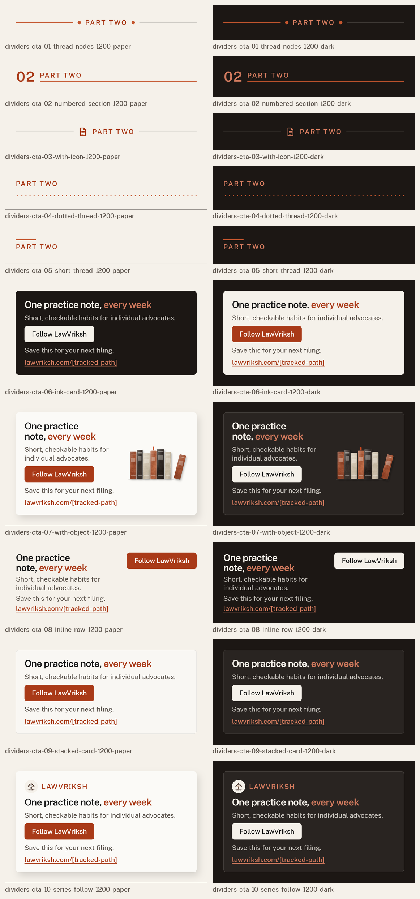

| Variant | Slots | 1200 | 720 |
|---|---|---|---|
| Divider 1 — thread-nodes | `label` | [html](graphics/dividers-cta-01-thread-nodes-1200.html) · [paper](previews/graphics/dividers-cta-01-thread-nodes-1200-paper.png) · [dark](previews/graphics/dividers-cta-01-thread-nodes-1200-dark.png) | [html](graphics/dividers-cta-01-thread-nodes-720.html) · [paper](previews/graphics/dividers-cta-01-thread-nodes-720-paper.png) · [dark](previews/graphics/dividers-cta-01-thread-nodes-720-dark.png) |
| Divider 2 — numbered-section | `label`, `number` | [html](graphics/dividers-cta-02-numbered-section-1200.html) · [paper](previews/graphics/dividers-cta-02-numbered-section-1200-paper.png) · [dark](previews/graphics/dividers-cta-02-numbered-section-1200-dark.png) | [html](graphics/dividers-cta-02-numbered-section-720.html) · [paper](previews/graphics/dividers-cta-02-numbered-section-720-paper.png) · [dark](previews/graphics/dividers-cta-02-numbered-section-720-dark.png) |
| Divider 3 — with-icon | `label` | [html](graphics/dividers-cta-03-with-icon-1200.html) · [paper](previews/graphics/dividers-cta-03-with-icon-1200-paper.png) · [dark](previews/graphics/dividers-cta-03-with-icon-1200-dark.png) | [html](graphics/dividers-cta-03-with-icon-720.html) · [paper](previews/graphics/dividers-cta-03-with-icon-720-paper.png) · [dark](previews/graphics/dividers-cta-03-with-icon-720-dark.png) |
| Divider 4 — dotted-thread | `label` | [html](graphics/dividers-cta-04-dotted-thread-1200.html) · [paper](previews/graphics/dividers-cta-04-dotted-thread-1200-paper.png) · [dark](previews/graphics/dividers-cta-04-dotted-thread-1200-dark.png) | [html](graphics/dividers-cta-04-dotted-thread-720.html) · [paper](previews/graphics/dividers-cta-04-dotted-thread-720-paper.png) · [dark](previews/graphics/dividers-cta-04-dotted-thread-720-dark.png) |
| Divider 5 — short-thread | `label` | [html](graphics/dividers-cta-05-short-thread-1200.html) · [paper](previews/graphics/dividers-cta-05-short-thread-1200-paper.png) · [dark](previews/graphics/dividers-cta-05-short-thread-1200-dark.png) | [html](graphics/dividers-cta-05-short-thread-720.html) · [paper](previews/graphics/dividers-cta-05-short-thread-720-paper.png) · [dark](previews/graphics/dividers-cta-05-short-thread-720-dark.png) |
| CTA block 6 — ink-card | `title_html`, `body_html`, `button`, `note`, `link` | [html](graphics/dividers-cta-06-ink-card-1200.html) · [paper](previews/graphics/dividers-cta-06-ink-card-1200-paper.png) · [dark](previews/graphics/dividers-cta-06-ink-card-1200-dark.png) | [html](graphics/dividers-cta-06-ink-card-720.html) · [paper](previews/graphics/dividers-cta-06-ink-card-720-paper.png) · [dark](previews/graphics/dividers-cta-06-ink-card-720-dark.png) |
| CTA block 7 — with-object | `title_html`, `body_html`, `button`, `note`, `link` | [html](graphics/dividers-cta-07-with-object-1200.html) · [paper](previews/graphics/dividers-cta-07-with-object-1200-paper.png) · [dark](previews/graphics/dividers-cta-07-with-object-1200-dark.png) | [html](graphics/dividers-cta-07-with-object-720.html) · [paper](previews/graphics/dividers-cta-07-with-object-720-paper.png) · [dark](previews/graphics/dividers-cta-07-with-object-720-dark.png) |
| CTA block 8 — inline-row | `title_html`, `body_html`, `button`, `note`, `link` | [html](graphics/dividers-cta-08-inline-row-1200.html) · [paper](previews/graphics/dividers-cta-08-inline-row-1200-paper.png) · [dark](previews/graphics/dividers-cta-08-inline-row-1200-dark.png) | [html](graphics/dividers-cta-08-inline-row-720.html) · [paper](previews/graphics/dividers-cta-08-inline-row-720-paper.png) · [dark](previews/graphics/dividers-cta-08-inline-row-720-dark.png) |
| CTA block 9 — stacked-card | `title_html`, `body_html`, `button`, `note`, `link` | [html](graphics/dividers-cta-09-stacked-card-1200.html) · [paper](previews/graphics/dividers-cta-09-stacked-card-1200-paper.png) · [dark](previews/graphics/dividers-cta-09-stacked-card-1200-dark.png) | [html](graphics/dividers-cta-09-stacked-card-720.html) · [paper](previews/graphics/dividers-cta-09-stacked-card-720-paper.png) · [dark](previews/graphics/dividers-cta-09-stacked-card-720-dark.png) |
| CTA block 10 — series-follow | `title_html`, `body_html`, `button`, `note`, `link` | [html](graphics/dividers-cta-10-series-follow-1200.html) · [paper](previews/graphics/dividers-cta-10-series-follow-1200-paper.png) · [dark](previews/graphics/dividers-cta-10-series-follow-1200-dark.png) | [html](graphics/dividers-cta-10-series-follow-720.html) · [paper](previews/graphics/dividers-cta-10-series-follow-720-paper.png) · [dark](previews/graphics/dividers-cta-10-series-follow-720-dark.png) |

Mobile sheet: [previews/graphics-dividers-cta-720-contact-sheet.png](previews/graphics-dividers-cta-720-contact-sheet.png). Schemas: `graphics/dividers-cta-NN-*.schema.json`.

Notes: timelines use placeholder dates only and are separate from Case Mapping. Pull statements carry no quotation marks and no attribution. The tracked-link slot (`link`) is shown as link text and set as the `href`. If a graphic needs the product, reuse `product/case-mapping.html` or `product/chronology.html` (both `requires_claim_approval: true`); this folder adds no product UI.

## 3. Article page

`article/article.html` + `article/article.css`: a self-contained, class-based reading layout for previewing a finished article from Markdown. Title, dek, byline/date/reading time, contents (built from the H2 headings, or supplied), H2/H3, body (19 px on a 700 px column), lists, tables, footnote-style sources, the callout and graphic components, and a closing CTA block. Paper (light reading mode) and dark via `data-theme`.

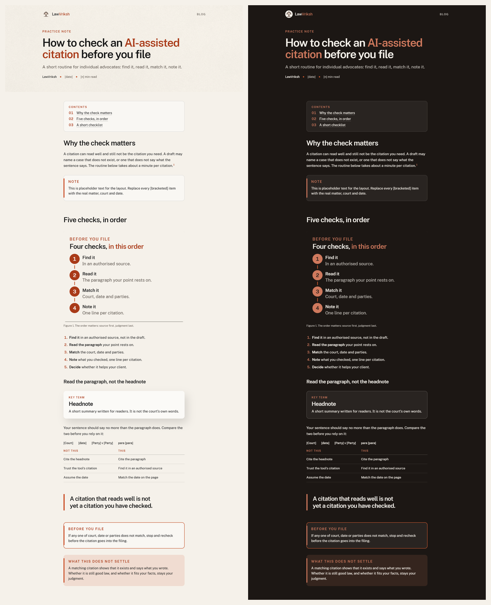

Slots: `kicker`, `title_html`, `dek`, `author`, `date`, `reading_time`, `contents`, `body_md`, `cta_title_html`, `cta_body_html`, `cta_button`, `cta_note`, `cta_link`. `body_md` is rendered by `LV.md` (`blog/blog.js`); raw HTML is never passed through, and `em` renders upright in clay.

| Markdown | Renders as |
|---|---|
| `##`, `###` | H2 / H3 (ids feed the contents list) |
| `**bold**`, `*accent*`, `` `code` `` | weight 600; clay (upright); chip |
| `[1]` | citation chip `.lv-cite` |
| `[^1]` + `[^1]: text` | footnote reference and `.lv-sources` list |
| tables, lists, `---` | `.lv-table`, lists, `.lv-divider` |
| `::: note` / `caution` / `settle` [label] | `.lv-callout` (`is-note`, `is-caution`, `is-settle`) |
| `::: term Name` | `.lv-term` key-term box |
| `::: pull` | `.lv-pull` (no quotation marks, no attribution) |
| `::: steps`, `::: checklist` | `.lv-steps`, `.lv-checks` (numbered / tick rows) |
| `::: figure src | alt | caption` | `.lv-figure`; `{theme}` in `src` is replaced by the current mode |
| `::: source Court | date | parties | para` | `.lv-source` line |
| `::: cta Button | note | link` | `.lv-cta` block |

The article page is a reading layout, so it follows the brief’s 18–20 px body rather than the 34 px-per-1080 rule, and the safe-area and minimum-size checks are not applied to it (they are shown as n/a). Every other check, including the slot audit, runs.

## 4. Self-check

`tools/render.mjs` runs every template in both themes in headless Chromium: the eight system checks (parameterised for these sizes: minimum text 40 px at 1200, 34 px at 1080, 24 px at 720), the **slot audit**, and for thumbnails the **1.91:1 crop band** (square and portrait) and **300 px legibility** (headline ≥ 16 px when the image is shown 300 px wide). Pages must also load with no console errors and no network requests. Raw results: [previews/checks.json](previews/checks.json).

**Slot audit** (`tools/audit.mjs`). For every slot in a template’s schema it fills a unique marker and requires the marker to be visible on the page (list slots get several items; enum slots such as `motif` must change the page; the image slot must show the image). It then requires that no text from the example JSON is still visible after the fill. Run it with `node blog/tools/audit.mjs --family <family> --index <index.json>`.

### Thumbnails

| Template | LawVriksh Sans only | No italics | Palette only | No text overlap | Safe area | Min size | Contrast | No arrows | Slot audit | Load |
|---|---|---|---|---|---|---|---|---|---|---|
| statement-only-og (23.5 px@300) | pass | pass | pass | pass | pass | pass | pass | pass | pass | pass |
| statement-only-sq (31.1 px@300, crop band pass) | pass | pass | pass | pass | pass | pass | pass | pass | pass | pass |
| statement-only-pt (33.3 px@300, crop band pass) | pass | pass | pass | pass | pass | pass | pass | pass | pass | pass |
| statement-object-og (18 px@300) | pass | pass | pass | pass | pass | pass | pass | pass | pass | pass |
| statement-object-sq (31.1 px@300, crop band pass) | pass | pass | pass | pass | pass | pass | pass | pass | pass | pass |
| statement-object-pt (33.3 px@300, crop band pass) | pass | pass | pass | pass | pass | pass | pass | pass | pass | pass |
| how-to-og (24 px@300) | pass | pass | pass | pass | pass | pass | pass | pass | pass | pass |
| how-to-sq (31.1 px@300, crop band pass) | pass | pass | pass | pass | pass | pass | pass | pass | pass | pass |
| how-to-pt (33.3 px@300, crop band pass) | pass | pass | pass | pass | pass | pass | pass | pass | pass | pass |
| question-og (21.5 px@300) | pass | pass | pass | pass | pass | pass | pass | pass | pass | pass |
| question-sq (31.1 px@300, crop band pass) | pass | pass | pass | pass | pass | pass | pass | pass | pass | pass |
| question-pt (33.3 px@300, crop band pass) | pass | pass | pass | pass | pass | pass | pass | pass | pass | pass |
| does-not-settle-og (22 px@300) | pass | pass | pass | pass | pass | pass | pass | pass | pass | pass |
| does-not-settle-sq (31.1 px@300, crop band pass) | pass | pass | pass | pass | pass | pass | pass | pass | pass | pass |
| does-not-settle-pt (33.3 px@300, crop band pass) | pass | pass | pass | pass | pass | pass | pass | pass | pass | pass |
| comparison-og (22 px@300) | pass | pass | pass | pass | pass | pass | pass | pass | pass | pass |
| comparison-sq (31.1 px@300, crop band pass) | pass | pass | pass | pass | pass | pass | pass | pass | pass | pass |
| comparison-pt (33.3 px@300, crop band pass) | pass | pass | pass | pass | pass | pass | pass | pass | pass | pass |
| checklist-teaser-og (22 px@300) | pass | pass | pass | pass | pass | pass | pass | pass | pass | pass |
| checklist-teaser-sq (31.1 px@300, crop band pass) | pass | pass | pass | pass | pass | pass | pass | pass | pass | pass |
| checklist-teaser-pt (33.3 px@300, crop band pass) | pass | pass | pass | pass | pass | pass | pass | pass | pass | pass |
| series-edition-og (24 px@300) | pass | pass | pass | pass | pass | pass | pass | pass | pass | pass |
| series-edition-sq (31.1 px@300, crop band pass) | pass | pass | pass | pass | pass | pass | pass | pass | pass | pass |
| series-edition-pt (33.3 px@300, crop band pass) | pass | pass | pass | pass | pass | pass | pass | pass | pass | pass |
| advocate-profile-og (19 px@300) | pass | pass | pass | pass | pass | pass | pass | pass | pass | pass |
| advocate-profile-sq (27.8 px@300, crop band pass) | pass | pass | pass | pass | pass | pass | pass | pass | pass | pass |
| advocate-profile-pt (30 px@300, crop band pass) | pass | pass | pass | pass | pass | pass | pass | pass | pass | pass |
| case-explained-og (24 px@300) | pass | pass | pass | pass | pass | pass | pass | pass | pass | pass |
| case-explained-sq (31.1 px@300, crop band pass) | pass | pass | pass | pass | pass | pass | pass | pass | pass | pass |
| case-explained-pt (33.3 px@300, crop band pass) | pass | pass | pass | pass | pass | pass | pass | pass | pass | pass |

### In-article graphics

| Template | LawVriksh Sans only | No italics | Palette only | No text overlap | Safe area | Min size | Contrast | No arrows | Slot audit | Load |
|---|---|---|---|---|---|---|---|---|---|---|
| process-steps-01-horizontal-badges | pass | pass | pass | pass | pass | pass | pass | pass | pass | pass |
| process-steps-02-horizontal-cards | pass | pass | pass | pass | pass | pass | pass | pass | pass | pass |
| process-steps-03-horizontal-rules | pass | pass | pass | pass | pass | pass | pass | pass | pass | pass |
| process-steps-04-vertical-thread | pass | pass | pass | pass | pass | pass | pass | pass | pass | pass |
| process-steps-05-vertical-cards | pass | pass | pass | pass | pass | pass | pass | pass | pass | pass |
| process-steps-06-vertical-list | pass | pass | pass | pass | pass | pass | pass | pass | pass | pass |
| process-steps-07-horizontal-stones | pass | pass | pass | pass | pass | pass | pass | pass | pass | pass |
| process-steps-08-grid-cards | pass | pass | pass | pass | pass | pass | pass | pass | pass | pass |
| process-steps-09-vertical-rail | pass | pass | pass | pass | pass | pass | pass | pass | pass | pass |
| process-steps-10-horizontal-underline | pass | pass | pass | pass | pass | pass | pass | pass | pass | pass |
| checklist-cards-01-card-rows | pass | pass | pass | pass | pass | pass | pass | pass | pass | pass |
| checklist-cards-02-before-you-file | pass | pass | pass | pass | pass | pass | pass | pass | pass | pass |
| checklist-cards-03-two-column | pass | pass | pass | pass | pass | pass | pass | pass | pass | pass |
| checklist-cards-04-ruled-square | pass | pass | pass | pass | pass | pass | pass | pass | pass | pass |
| checklist-cards-05-numbered-rows | pass | pass | pass | pass | pass | pass | pass | pass | pass | pass |
| checklist-cards-06-pill-checks | pass | pass | pass | pass | pass | pass | pass | pass | pass | pass |
| checklist-cards-07-thread-spine | pass | pass | pass | pass | pass | pass | pass | pass | pass | pass |
| checklist-cards-08-ink-card | pass | pass | pass | pass | pass | pass | pass | pass | pass | pass |
| checklist-cards-09-list-and-note | pass | pass | pass | pass | pass | pass | pass | pass | pass | pass |
| checklist-cards-10-inline-compact | pass | pass | pass | pass | pass | pass | pass | pass | pass | pass |
| comparison-01-side-by-side-link | pass | pass | pass | pass | pass | pass | pass | pass | pass | pass |
| comparison-02-stacked-link | pass | pass | pass | pass | pass | pass | pass | pass | pass | pass |
| comparison-03-split-panel | pass | pass | pass | pass | pass | pass | pass | pass | pass | pass |
| comparison-04-struck-left | pass | pass | pass | pass | pass | pass | pass | pass | pass | pass |
| comparison-05-paragraph-and-sentence | pass | pass | pass | pass | pass | pass | pass | pass | pass | pass |
| comparison-06-table-plain | pass | pass | pass | pass | pass | pass | pass | pass | pass | pass |
| comparison-07-table-banded | pass | pass | pass | pass | pass | pass | pass | pass | pass | pass |
| comparison-08-table-marks | pass | pass | pass | pass | pass | pass | pass | pass | pass | pass |
| comparison-09-row-cards | pass | pass | pass | pass | pass | pass | pass | pass | pass | pass |
| comparison-10-table-compact | pass | pass | pass | pass | pass | pass | pass | pass | pass | pass |
| timeline-01-vertical-thread | pass | pass | pass | pass | pass | pass | pass | pass | pass | pass |
| timeline-02-vertical-cards | pass | pass | pass | pass | pass | pass | pass | pass | pass | pass |
| timeline-03-horizontal-thread | pass | pass | pass | pass | pass | pass | pass | pass | pass | pass |
| timeline-04-horizontal-cards | pass | pass | pass | pass | pass | pass | pass | pass | pass | pass |
| timeline-05-dated-list | pass | pass | pass | pass | pass | pass | pass | pass | pass | pass |
| timeline-06-pending-last | pass | pass | pass | pass | pass | pass | pass | pass | pass | pass |
| timeline-07-stepped | pass | pass | pass | pass | pass | pass | pass | pass | pass | pass |
| timeline-08-date-chips | pass | pass | pass | pass | pass | pass | pass | pass | pass | pass |
| timeline-09-milestone-grid | pass | pass | pass | pass | pass | pass | pass | pass | pass | pass |
| timeline-10-compact-thread | pass | pass | pass | pass | pass | pass | pass | pass | pass | pass |
| document-callouts-01-page-and-note | pass | pass | pass | pass | pass | pass | pass | pass | pass | pass |
| document-callouts-02-draft-vs-source | pass | pass | pass | pass | pass | pass | pass | pass | pass | pass |
| document-callouts-03-margin-and-chip | pass | pass | pass | pass | pass | pass | pass | pass | pass | pass |
| document-callouts-04-stacked-pages | pass | pass | pass | pass | pass | pass | pass | pass | pass | pass |
| document-callouts-05-connected-note | pass | pass | pass | pass | pass | pass | pass | pass | pass | pass |
| document-callouts-06-open-report | pass | pass | pass | pass | pass | pass | pass | pass | pass | pass |
| document-callouts-07-numbered-pins | pass | pass | pass | pass | pass | pass | pass | pass | pass | pass |
| document-callouts-08-draft-vs-source-verdict | pass | pass | pass | pass | pass | pass | pass | pass | pass | pass |
| document-callouts-09-filing-page | pass | pass | pass | pass | pass | pass | pass | pass | pass | pass |
| document-callouts-10-page-and-source-line | pass | pass | pass | pass | pass | pass | pass | pass | pass | pass |
| definition-boxes-01-card | pass | pass | pass | pass | pass | pass | pass | pass | pass | pass |
| definition-boxes-02-term-column | pass | pass | pass | pass | pass | pass | pass | pass | pass | pass |
| definition-boxes-03-thread-underline | pass | pass | pass | pass | pass | pass | pass | pass | pass | pass |
| definition-boxes-04-dictionary | pass | pass | pass | pass | pass | pass | pass | pass | pass | pass |
| definition-boxes-05-chip-term | pass | pass | pass | pass | pass | pass | pass | pass | pass | pass |
| definition-boxes-06-with-object | pass | pass | pass | pass | pass | pass | pass | pass | pass | pass |
| definition-boxes-07-not-to-be-confused | pass | pass | pass | pass | pass | pass | pass | pass | pass | pass |
| definition-boxes-08-inline | pass | pass | pass | pass | pass | pass | pass | pass | pass | pass |
| definition-boxes-09-ink-card | pass | pass | pass | pass | pass | pass | pass | pass | pass | pass |
| definition-boxes-10-two-terms | pass | pass | pass | pass | pass | pass | pass | pass | pass | pass |
| callout-boxes-01-note-bar | pass | pass | pass | pass | pass | pass | pass | pass | pass | pass |
| callout-boxes-02-note-icon | pass | pass | pass | pass | pass | pass | pass | pass | pass | pass |
| callout-boxes-03-caution | pass | pass | pass | pass | pass | pass | pass | pass | pass | pass |
| callout-boxes-04-does-not-settle | pass | pass | pass | pass | pass | pass | pass | pass | pass | pass |
| callout-boxes-05-outlined | pass | pass | pass | pass | pass | pass | pass | pass | pass | pass |
| callout-boxes-06-ink-card | pass | pass | pass | pass | pass | pass | pass | pass | pass | pass |
| callout-boxes-07-thread-dot | pass | pass | pass | pass | pass | pass | pass | pass | pass | pass |
| callout-boxes-08-tab-label | pass | pass | pass | pass | pass | pass | pass | pass | pass | pass |
| callout-boxes-09-icon-column | pass | pass | pass | pass | pass | pass | pass | pass | pass | pass |
| callout-boxes-10-hatch-strip | pass | pass | pass | pass | pass | pass | pass | pass | pass | pass |
| pull-statements-01-clay-bar | pass | pass | pass | pass | pass | pass | pass | pass | pass | pass |
| pull-statements-02-between-threads | pass | pass | pass | pass | pass | pass | pass | pass | pass | pass |
| pull-statements-03-plain-large | pass | pass | pass | pass | pass | pass | pass | pass | pass | pass |
| pull-statements-04-ink-card | pass | pass | pass | pass | pass | pass | pass | pass | pass | pass |
| pull-statements-05-card-with-node | pass | pass | pass | pass | pass | pass | pass | pass | pass | pass |
| pull-statements-06-with-object | pass | pass | pass | pass | pass | pass | pass | pass | pass | pass |
| pull-statements-07-underlined-phrase | pass | pass | pass | pass | pass | pass | pass | pass | pass | pass |
| pull-statements-08-paragraph-mark | pass | pass | pass | pass | pass | pass | pass | pass | pass | pass |
| pull-statements-09-thread-top | pass | pass | pass | pass | pass | pass | pass | pass | pass | pass |
| pull-statements-10-minimal | pass | pass | pass | pass | pass | pass | pass | pass | pass | pass |
| source-lines-01-inline-dots | pass | pass | pass | pass | pass | pass | pass | pass | pass | pass |
| source-lines-02-chips | pass | pass | pass | pass | pass | pass | pass | pass | pass | pass |
| source-lines-03-label-value | pass | pass | pass | pass | pass | pass | pass | pass | pass | pass |
| source-lines-04-four-columns | pass | pass | pass | pass | pass | pass | pass | pass | pass | pass |
| source-lines-05-pinpoint-chip | pass | pass | pass | pass | pass | pass | pass | pass | pass | pass |
| source-lines-06-table-row | pass | pass | pass | pass | pass | pass | pass | pass | pass | pass |
| source-lines-07-numbered-source | pass | pass | pass | pass | pass | pass | pass | pass | pass | pass |
| source-lines-08-two-sources | pass | pass | pass | pass | pass | pass | pass | pass | pass | pass |
| source-lines-09-mark-bar | pass | pass | pass | pass | pass | pass | pass | pass | pass | pass |
| source-lines-10-tag-line | pass | pass | pass | pass | pass | pass | pass | pass | pass | pass |
| dividers-cta-01-thread-nodes | pass | pass | pass | pass | pass | pass | pass | pass | pass | pass |
| dividers-cta-02-numbered-section | pass | pass | pass | pass | pass | pass | pass | pass | pass | pass |
| dividers-cta-03-with-icon | pass | pass | pass | pass | pass | pass | pass | pass | pass | pass |
| dividers-cta-04-dotted-thread | pass | pass | pass | pass | pass | pass | pass | pass | pass | pass |
| dividers-cta-05-short-thread | pass | pass | pass | pass | pass | pass | pass | pass | pass | pass |
| dividers-cta-06-ink-card | pass | pass | pass | pass | pass | pass | pass | pass | pass | pass |
| dividers-cta-07-with-object | pass | pass | pass | pass | pass | pass | pass | pass | pass | pass |
| dividers-cta-08-inline-row | pass | pass | pass | pass | pass | pass | pass | pass | pass | pass |
| dividers-cta-09-stacked-card | pass | pass | pass | pass | pass | pass | pass | pass | pass | pass |
| dividers-cta-10-series-follow | pass | pass | pass | pass | pass | pass | pass | pass | pass | pass |

### Article page

| Template | LawVriksh Sans only | No italics | Palette only | No text overlap | Safe area | Min size | Contrast | No arrows | Slot audit | Load |
|---|---|---|---|---|---|---|---|---|---|---|
| article | pass | pass | pass | pass | n/a | n/a | pass | pass | pass | pass |

Each graphics row aggregates its four renders (two widths × two themes).

### Existing library: slot audit findings (report only)

Running the same audit over the **existing** `carousel/`, `static/` and `reel/` templates (46 audited) found these failures. They are listed here, not fixed: the brief says not to change existing files, and the branch `lawvriksh-system-fixes` was not found on the remote. Full output: [previews/existing-library-slot-audit.json](previews/existing-library-slot-audit.json).

| Template | What the audit found |
|---|---|
| `carousel/advocate-cover.html` | body_html: value does not appear |
| `reel/document-highlight.html` | lines: value does not appear |
| `reel/strike-list.html` | example text: example text still visible after fill; struck: value does not appear |
| `reel/step.html` | steps: step count does not render |
| `reel/big-number.html` | number: value does not appear |

46 audited, 5 failing. Likely causes: `carousel/advocate-cover` has a `body_html` slot but no element for it; `reel/document-highlight` (`lines`) and `reel/step` (`steps`) declare counts the markup does not render; `reel/strike-list` fills `struck` as a list but the markup is static; `reel/big-number` caches its first numeral and overwrites a filled `number`.

## Rebuilding

```bash
node lawvriksh-system/blog/tools/build.mjs                      # templates, schemas, examples
node lawvriksh-system/blog/tools/render.mjs --only thumbnails   # previews + checks (run one family per process: graphics --group <family>)
python lawvriksh-system/blog/tools/finalize.py                  # sheets, README, manifest
```

`render.mjs` uses an existing `puppeteer-core` and Chromium and installs nothing. Tools: `build*.mjs` (generators), `render.mjs`, `checks.mjs` (parameterised copy of the system checker), `audit.mjs`, `sheet.py`, `finalize.py`.

## Rights and provenance

| Material | Source | Licence / note |
|---|---|---|
| LawVriksh Sans | `lawvriksh-system/fonts/` (existing) | SIL Open Font License 1.1 |
| Textures, mark | `brand/` (existing, referenced in place) | As recorded in `ASSET-RIGHTS.md` |
| Templates, CSS/JS, graphics, icons (inline SVG), law objects | Original work for LawVriksh in this branch | No stock imagery, faces, emblems or other brands’ marks; the court facade is generic with an empty pediment |
| Document pages | Original vectors with greeked bars | No readable invented legal text |

